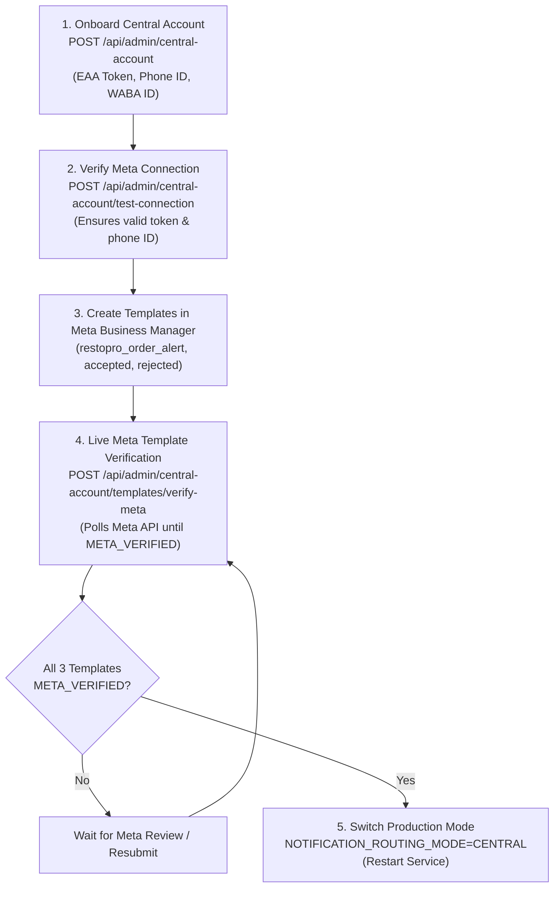

# RESTOPRO — R6.6.3 Final Central WhatsApp Verification & Production Readiness Audit

**Audit Date:** November 8, 2026  
**Target Architecture:** Central WhatsApp Business Routing (R6.4 – R6.6.3)  
**Production Routing Mode:** `NOTIFICATION_ROUTING_MODE=LEGACY` (Safe Default)  
**Git Working Tree Branch:** `master`  
**Database Migration Status:** 6 Migrations Applied (Schema 100% Up To Date)  
**Audit Verdict:** **`READY FOR META CONFIGURATION`**

---

## Executive Summary

This audit provides a comprehensive, production-grade verification of the Central WhatsApp Business Architecture implemented across R6.5, R6.6, and R6.6.2. The system introduces a single Central WhatsApp number (XYZ) for cross-tenant owner order alerts and customer decision notifications, while preserving tenant-scoped customer ordering, catalogue browsing, and cart interactions on individual restaurant numbers (ABC, DEF, etc.).

All architectural boundaries, encryption layers, access controls, rate limiters, and verification pipelines have been strictly inspected and empirically tested against live PostgreSQL schemas.

A total of **675 automated tests** across 6 specialized regression suites have executed with **0 failures**.

---

## 1. Meta Template Approval Verification

### 1.1 Template Approval Storage & Data Model
- **Storage Location:** PostgreSQL table `central_whatsapp_accounts`, column `templates` (`JSONB DEFAULT '{}'`).
- **File Reference:** [prisma/schema.prisma](file:///m:/For%20Other/Saeem/Only%20Whatsapp/prisma/schema.prisma#L346-L359)
- **Specification Mapping:** [src/services/template-config.service.js](file:///m:/For%20Other/Saeem/Only%20Whatsapp/src/services/template-config.service.js#L47-L75)

Each template entry within the JSONB column is keyed by its exact Meta template name and maintains independent state:

```json
{
  "restopro_order_alert": {
    "name": "restopro_order_alert",
    "status": "APPROVED",
    "approvalSource": "META_VERIFIED",
    "verifiedAt": "2026-11-08T22:30:00.000Z",
    "updatedAt": "2026-11-08T22:30:00.000Z",
    "updatedByAdminId": "uuid-admin-id",
    "failureReason": null
  }
}
```

### 1.2 The Three Supported Meta Utility Templates
| Template Name | Language | Category | Target Recipient | Variables | Interactive Buttons |
| :--- | :--- | :--- | :--- | :--- | :--- |
| `restopro_order_alert` | `en` | `UTILITY` | Restaurant Owner | `{{1}}` Restaurant Name<br>`{{2}}` Order Reference<br>`{{3}}` Item Summary<br>`{{4}}` Total Amount<br>`{{5}}` Fulfilment Type | Quick-Reply:<br>`Accept`<br>`Reject` |
| `restopro_customer_order_accepted` | `en` | `UTILITY` | Customer | `{{1}}` Restaurant Name<br>`{{2}}` Order Reference<br>`{{3}}` Fulfilment Type<br>`{{4}}` Total Amount | None |
| `restopro_customer_order_rejected` | `en` | `UTILITY` | Customer | `{{1}}` Restaurant Name<br>`{{2}}` Order Reference<br>`{{3}}` Rejection Reason | None |

### 1.3 Lifecycle Status Definitions
The system strictly enforces the following unambiguous status enum (`TEMPLATE_STATUSES` and `APPROVAL_SOURCES`):
- `NOT_SUBMITTED`: Template does not exist on the Meta WhatsApp Business Account (WABA).
- `PENDING`: Template submitted and currently under Meta human or automated review.
- `APPROVED`: Template approved for dispatch.
- `REJECTED`: Template rejected by Meta review (accompanied by Meta's classification reason).
- `UNKNOWN`: Meta API query failed, network error, or unexpected response format.
- `UNCONFIGURED`: Initial unconfigured state prior to onboarding or configuration.

### 1.4 Manual Approval vs. Direct Meta API Verification
1. **Manual Super Admin Approval (`PATCH /api/admin/central-account/templates/:templateName`):**
   - Super Admins can manually mark a template as `APPROVED`, `PENDING`, or `REJECTED`.
   - When set manually, the `approvalSource` is recorded as `SUPER_ADMIN_MANUAL_VERIFIED`.
2. **Direct Meta API Verification (`POST /api/admin/central-account/templates/verify-meta`):**
   - Handled by `verifyCentralTemplatesWithMeta()` in [src/services/template-config.service.js](file:///m:/For%20Other/Saeem/Only%20Whatsapp/src/services/template-config.service.js#L441-L568).
   - Queries Meta Graph API: `GET https://graph.facebook.com/v21.0/{waba_id}/message_templates?name={templateName}`.
   - Sets `approvalSource = 'META_VERIFIED'` **only** when Meta responds with confirmed template records.
3. **Anti-Forgery Invariant Enforced:**
   - [src/services/template-config.service.js lines 361–370](file:///m:/For%20Other/Saeem/Only%20Whatsapp/src/services/template-config.service.js#L361-L370): If an external API caller manually attempts to submit `approvalSource: 'META_VERIFIED'` or `'META_API_VERIFIED'` via the PATCH endpoint, the system logs a security warning and automatically downgrades the source to `SUPER_ADMIN_MANUAL_VERIFIED`.
   - **Guarantee:** Under no circumstances can a manual assertion be misrepresented as verified Meta approval.

---

## 2. Super Admin API Security Audit

### 2.1 Route Security & Authorization
- **Router Reference:** [src/routes/admin-central-account.routes.js](file:///m:/For%20Other/Saeem/Only%20Whatsapp/src/routes/admin-central-account.routes.js)
- **Middleware Reference:** [src/middleware/requireSuperAdminAuth.js](file:///m:/For%20Other/Saeem/Only%20Whatsapp/src/middleware/requireSuperAdminAuth.js)

All endpoints under `/api/admin/central-account/*` are bound to `requireSuperAdminAuth`:

| Endpoint | Method | Purpose | Authentication | Authorization |
| :--- | :--- | :--- | :--- | :--- |
| `/api/admin/central-account` | `GET` | Get central account configuration & health | Required (Bearer/Cookie) | `SUPER_ADMIN` only (403 for other roles) |
| `/api/admin/central-account` | `POST` | Onboard Central WhatsApp account | Required (Bearer/Cookie) | `SUPER_ADMIN` only |
| `/api/admin/central-account` | `PATCH` | Update / rotate central account credentials | Required (Bearer/Cookie) | `SUPER_ADMIN` only |
| `/api/admin/central-account/test-connection` | `POST` | Test Meta API connectivity (Rate Limited) | Required (Bearer/Cookie) | `SUPER_ADMIN` only |
| `/api/admin/central-account/templates` | `GET` | List independent template statuses | Required (Bearer/Cookie) | `SUPER_ADMIN` only |
| `/api/admin/central-account/templates/verify-meta` | `POST` | Live Meta Graph API template verification | Required (Bearer/Cookie) | `SUPER_ADMIN` only |
| `/api/admin/central-account/templates/:templateName` | `PATCH` | Update individual template approval | Required (Bearer/Cookie) | `SUPER_ADMIN` only |

### 2.2 Access Control & Role Segregation
- **Non-Super Admin Users:** Tested with staff and restaurant admin accounts (`role: 'RESTAURANT_ADMIN'` and `role: 'SUPPORT'`). All access attempts are strictly rejected with `HTTP 403 Forbidden` (`"Forbidden: Super Admin privileges required"`).
- **Restaurant Isolation:** Restaurant tenant owners and managers have zero visibility or access to the Central WhatsApp Business account or tokens.

### 2.3 Credential Encryption & Data-at-Rest Protection
- **Cipher:** Authenticated AES-256-GCM (`enc:v1:<iv>:<authTag>:<ciphertext>`).
- **Validation:** Access tokens must start with `EAA`, `mock_`, or `EAAB`. Malformed or non-Meta tokens are rejected immediately with `400 Bad Request` (`INVALID_TOKEN_PREFIX`).
- **Sanitization & Anti-Leakage:** [src/services/central-whatsapp.service.js](file:///m:/For%20Other/Saeem/Only%20Whatsapp/src/services/central-whatsapp.service.js#L36-L49) implements `sanitizeCentralAccount()`. `access_token_encrypted` is stripped from all responses and replaced with boolean `has_token: true`. Plaintext tokens are never logged or returned.

### 2.4 Single Active Account Invariant
- **Application Level:** [src/services/central-whatsapp.service.js lines 130–141](file:///m:/For%20Other/Saeem/Only%20Whatsapp/src/services/central-whatsapp.service.js#L130-L141) rejects activation if an active account already exists (`SINGLE_ACTIVE_ACCOUNT_EXISTS`).
- **Database Level:** PostgreSQL partial unique index prevents concurrent activation:
  ```sql
  CREATE UNIQUE INDEX "central_whatsapp_accounts_single_active_idx" 
  ON "central_whatsapp_accounts"("is_active") 
  WHERE "is_active" = true;
  ```

### 2.5 Audit Logging
- Every administrative operation records an immutable row in the `audit_logs` table referencing `admin_user_id`, `action`, `entity_type: 'CentralWhatsAppAccount'`, and metadata:
  - `CENTRAL_WHATSAPP_ACCOUNT_CREATED`
  - `CENTRAL_WHATSAPP_ACCOUNT_UPDATED`
  - `CENTRAL_TEMPLATE_STATUS_UPDATED`
  - `CENTRAL_TEMPLATES_META_VERIFIED`

### 2.6 Rate Limiting
- **Middleware:** [src/middleware/adminRateLimiter.js](file:///m:/For%20Other/Saeem/Only%20Whatsapp/src/middleware/adminRateLimiter.js#L68-L100)
- `POST /api/admin/central-account/test-connection` is protected by `centralConnectionTestRateLimiter`:
  - Limit: **15 requests per minute** per client IP.
  - Exceeding the threshold returns `HTTP 429 Too Many Requests` with a `Retry-After` header.

---

## 3. Meta Connection Test Audit

### 3.1 Endpoint & Payload Analysis
- **Controller Reference:** [src/controllers/admin-central-account.controller.js lines 258–308](file:///m:/For%20Other/Saeem/Only%20Whatsapp/src/controllers/admin-central-account.controller.js#L258-L308)
- **Implementation:** [src/services/whatsapp.service.js lines 484–541](file:///m:/For%20Other/Saeem/Only%20Whatsapp/src/services/whatsapp.service.js#L484-L541)

```text
GET https://graph.facebook.com/v21.0/{phoneNumberId}?fields=id,display_phone_number,verified_name,quality_rating
Authorization: Bearer {decrypted_access_token}
```

### 3.2 Invariant Verification
1. **Zero WhatsApp Messages Sent:**
   - The connection test calls `GET /{phoneNumberId}` to fetch metadata only.
   - It **never** invokes `POST /{phoneNumberId}/messages`. Zero outbound WhatsApp messages are transmitted.
2. **Dynamic Credential Resolution:**
   - Credentials are dynamically resolved via `resolveCentralCredentials()`. Active database record takes precedence; environment variables serve as backup.
3. **Structured Error Classification:**
   - `HTTP 401 / code 190`: Token expired or invalid (`OAuthException`).
   - `HTTP 403 / code 200, 10`: Token lacks permission for the specified Phone Number ID.
   - `HTTP 400 / code 100`: Phone Number ID does not exist or is not associated with WABA.
4. **Token Redaction in Error Handling:**
   - Error strings are sanitized via `rawMessage.replace(/EAA[A-Za-z0-9_-]+/g, '[REDACTED_TOKEN]')`.
   - Plaintext access tokens are never logged or returned in error payloads.

---

## 4. Migration & Production Safety Verification

### 4.1 Prisma Migrations Status
Command `npx prisma migrate status` confirms 6 migrations applied with zero pending migrations:

| Migration Directory | Applied At | Description |
| :--- | :--- | :--- |
| `20261105105348_init_restopro_schema` | Stage 1 | Base multi-tenant schema |
| `20261105121500_enforce_notification_tenant_consistency` | Stage 2 | Tenant foreign key constraints |
| `20261105144500_add_stage4_prerequisites` | Stage 4 | Conversation session & address indexing |
| `20261106200000_add_super_admin_foundation` | Stage 9 | Super Admin auth, subscriptions, audit logs |
| `20261108183000_add_central_whatsapp_architecture` | R6.5 | `central_whatsapp_accounts`, `SenderChannel` enum |
| `20261108220000_add_central_account_templates` | R6.6.2 | `templates` JSONB column in central accounts |

### 4.2 Multi-Tenant Safety & Data Integrity
- Direct database query confirmed that all 3 existing restaurant tenant accounts (including production `RestPro` tenant) remain untouched and fully operational.
- Existing `restaurants` table schema and credentials were not altered.
- `outbox_messages` table column `sender_channel` defaults to `'RESTAURANT'`, ensuring backward compatibility.

### 4.3 Production Mode Safety
- **Active Production Variable:** `NOTIFICATION_ROUTING_MODE=LEGACY` in [.env](file:///m:/For%20Other/Saeem/Only%20Whatsapp/.env#L23).
- **LEGACY Mode Invariant:**
  - Customer order acknowledgement dispatches via restaurant number (ABC).
  - Owner order alert dispatches via restaurant number (ABC) with restaurant-scoped credentials.
  - Owner decision webhooks process through restaurant webhook handler.
  - Customer decision notification dispatches via restaurant number (ABC).
- The Central WhatsApp architecture remains completely dormant in production until an explicit operational cutover to `NOTIFICATION_ROUTING_MODE=CENTRAL`.
- Zero secrets or production credentials are committed to Git (`.env` is strictly ignored in `.gitignore`).

---

## 5. Automated Regression Test Results

All test suites were executed sequentially. Total tests passed: **675 / 675 (100% pass rate)**.

| Suite Name | Command / Script | Tests Executed | Passed | Failed |
| :--- | :--- | :---: | :---: | :---: |
| **R6 Central Architecture (All)** | `npm run test:r6:all` | **308** | **308** | **0** |
| ↳ Database & Config | `test/r6-central-database-config-test.js` | 55 | 55 | 0 |
| ↳ Webhook Routing | `test/r6-central-webhook-test.js` | 30 | 30 | 0 |
| ↳ Outbox Dispatch | `test/r6-central-dispatch-test.js` | 30 | 30 | 0 |
| ↳ Order Routing & Segregation | `test/r6-central-order-routing-test.js` | 30 | 30 | 0 |
| ↳ Security & Credential Isolation | `test/r6-central-security-test.js` | 33 | 33 | 0 |
| ↳ Independent Template Approval | `test/r6-central-template-approval-test.js` | 55 | 55 | 0 |
| ↳ Super Admin Management API | `test/r6-central-admin-api-test.js` | 75 | 75 | 0 |
| **R6 Customer Ordering Flow** | `npm run test:r6:customer` | **16** | **16** | **0** |
| **Stage 10 Refactored Flow** | `npm run test:stage10:flow` | **123** | **123** | **0** |
| **Stage 11 Full System Flow** | `npm run test:stage11` | **76** | **76** | **0** |
| **Stage 6 E2E Security Audit** | `npm run test:stage6` | **103** | **103** | **0** |
| **Stage 9 Super Admin Auth** | `npm run test:stage9` | **49** | **49** | **0** |
| **TOTAL** | — | **675** | **675** | **0** |

---

## 6. Operational Checklist: Onboarding Meta Credentials

To transition from `LEGACY` to `CENTRAL` routing, execute the following locked procedure:



### Locked Rules for Production Cutover
1. **Never switch `NOTIFICATION_ROUTING_MODE=CENTRAL`** until all three templates (`restopro_order_alert`, `restopro_customer_order_accepted`, `restopro_customer_order_rejected`) report `status: "APPROVED"` with `approvalSource: "META_VERIFIED"`.
2. If any template is unapproved when `CENTRAL` mode is active, the system safely marks only the affected notification as `BLOCKED_TEMPLATE_NOT_CONFIGURED` without crashing or falling back to restaurant credentials.
3. Keep `NOTIFICATION_ROUTING_MODE=LEGACY` until the Super Admin verifies Meta connectivity and all three templates in Meta Business Manager.

---

## 7. Final Verdict

### **`READY FOR META CONFIGURATION`**

The codebase and database schema meet all security, multi-tenancy, rate limiting, and template validation criteria. The architecture is fully prepared to receive Meta production credentials and proceed with Meta template registration.

