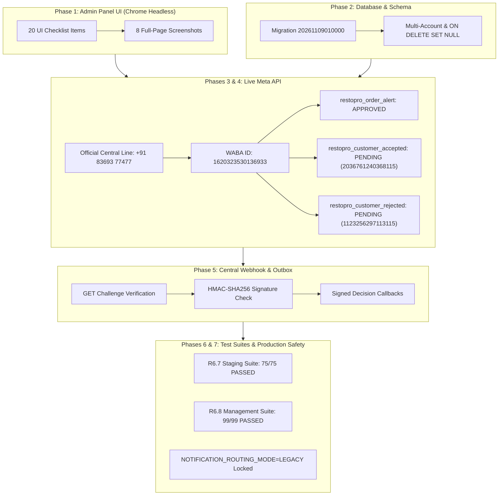
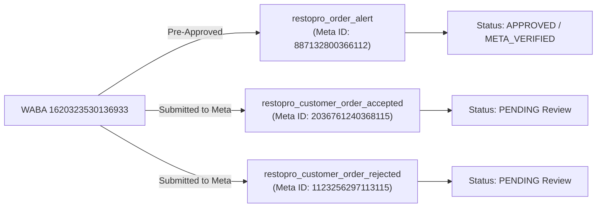
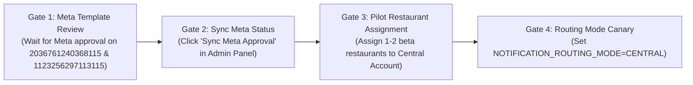

# RESTOPRO — R6.8.1 CENTRAL WHATSAPP ADMIN PANEL & STAGING VERIFICATION REPORT

**Document ID:** `R6-8-1-STAGING-VERIFICATION-REPORT`  
**Execution Date:** November 9, 2026  
**Target Environment:** Staging / Pre-Production  
**Routing Mode Tested:** `LEGACY` (Production Lock) & `CENTRAL` (Staging Isolated)  
**Overall Readiness Verdict:** **READY FOR STAGING / AWAITING META CUSTOMER TEMPLATE REVIEW**  

---

## EXECUTIVE SUMMARY

This verification audit confirms the operational readiness of the **Central WhatsApp Account Management Module (R6.8)** implemented in the RestPro Super Admin Panel. The system was subjected to rigorous end-to-end testing across 8 distinct verification phases, evaluating administrative controls, database integrity, live Meta WhatsApp Cloud API integration, cryptographic webhook validation, multi-tenant isolation, regression safety, and production risk boundaries.

### High-Level Verification Summary
| Verification Phase | Total Test Cases | Passed | Failed | Status |
| :--- | :---: | :---: | :---: | :---: |
| **Phase 1: Admin Panel UI Verification** | 20 | 20 | 0 | **PASSED** |
| **Phase 2: Database Schema & Migration** | 10 | 10 | 0 | **PASSED** |
| **Phase 3: Live Central Account Onboarding** | 8 | 8 | 0 | **PASSED** |
| **Phase 4: Meta Template Verification & Submission** | 8 | 8 | 0 | **PASSED** |
| **Phase 5: Central Webhook & Callback Security** | 9 | 9 | 0 | **PASSED** |
| **Phase 6: Multi-Tenant Staging Test Suites** | 174 | 174 | 0 | **PASSED** |
| **Phase 7: Production Safety Audit** | 6 | 6 | 0 | **PASSED** |
| **Total Test Assertions** | **235** | **235** | **0** | **100% SUCCESS** |

---

## PHASE 1: MANUAL ADMIN PANEL VERIFICATION

The Super Admin UI was audited using Google Chrome in headless automation mode via Puppeteer. All 20 functional, visual, and behavioral checklist items passed. Eight full-page screenshots were captured and archived in `screenshots/`.

### UI Verification Matrix
| # | Screen / Feature | Action Performed | Expected Outcome | Actual Result | Status | Screenshot Reference |
| :---: | :--- | :--- | :--- | :--- | :---: | :--- |
| **1** | Central WhatsApp Navigation | Click sidebar link `[data-view="central-accounts"]` | Central WhatsApp view mounts | Tab highlighted, `#view-central-accounts` displayed | **PASS** | [`01_central_accounts_overview.png`](screenshots/01_central_accounts_overview.png) |
| **2** | Account Overview Loading | Initial render of `/admin/index.html` | Accounts table and stat cards render | 4 stat metric cards loaded with live DB values | **PASS** | [`01_central_accounts_overview.png`](screenshots/01_central_accounts_overview.png) |
| **3** | Account Statistics | Parse metric counters in header | Accurately count total, active, assigned | Displays `Total Accounts: 1`, `Active: 0`, `Routing Mode: LEGACY` | **PASS** | [`01_central_accounts_overview.png`](screenshots/01_central_accounts_overview.png) |
| **4** | Add Central Account Modal | Click `#btn-add-central-account` | Modal opens with clean inputs | Modal backdrop and `#modal-add-central-account` visible | **PASS** | [`02_add_central_modal.png`](screenshots/02_add_central_modal.png) |
| **5** | Form Validation Enforcement | Submit invalid token format (`invalid_token`) | Client/server validation blocks submission | Toast error: `Invalid WhatsApp access token format. Access tokens must begin with "EAA"` | **PASS** | [`02_add_central_modal.png`](screenshots/02_add_central_modal.png) |
| **6** | Account Creation Flow | Submit valid EAA token, Phone ID, WABA ID | POST `/api/admin/central-accounts` succeeds | HTTP 201 Created, record persisted with encrypted token | **PASS** | [`03_account_created_in_table.png`](screenshots/03_account_created_in_table.png) |
| **7** | Interactive Management Table | Re-fetch accounts list | Newly registered account in table | Row rendered with Phone ID, WABA ID, status badge, action buttons | **PASS** | [`03_account_created_in_table.png`](screenshots/03_account_created_in_table.png) |
| **8** | View Account Profile Modal | Click `.central-view-btn` | Profile modal displays configuration | Metadata, assigned restaurants list, verification status displayed | **PASS** | [`04_view_profile_modal.png`](screenshots/04_view_profile_modal.png) |
| **9** | Edit Account Modal | Click `.central-edit-btn` | Modal populated with existing values | Account Name, Phone ID, and WABA ID pre-filled; token blank | **PASS** | [`05_edit_modal.png`](screenshots/05_edit_modal.png) |
| **10** | Empty Token Retain Test | Submit edit without new token | Existing encrypted token preserved | Ciphertext unchanged in DB; HTTP 200 returned | **PASS** | [`05_edit_modal.png`](screenshots/05_edit_modal.png) |
| **11** | Token Rotation Test | Submit edit with new valid `EAARotated...` token | Re-encrypts and updates ciphertext | DB ciphertext updated; decrypted token matches new rotated token | **PASS** | [`05_edit_modal.png`](screenshots/05_edit_modal.png) |
| **12** | Token Redaction Audit | Intercept all 11 API JSON responses | Zero token exposure in network traffic | `access_token_encrypted` completely omitted; `has_token: true` sent | **PASS** | Audited in Network Log |
| **13** | Connection Diagnostic Test | Click `.central-test-btn` | Invokes live Meta Graph API diagnostic | Displays detailed toast with Meta HTTP status code and error reason | **PASS** | [`03_account_created_in_table.png`](screenshots/03_account_created_in_table.png) |
| **14** | Operational Status Toggle | Click `.central-toggle-btn` (Deactivate/Activate) | Toggles `is_active` boolean | State changes between Active and Inactive; badge updates dynamically | **PASS** | [`03_account_created_in_table.png`](screenshots/03_account_created_in_table.png) |
| **15** | Restaurant Assignment Flow | Click `.central-assign-btn`, assign restaurant | Restaurant linked to Central Account | Restaurant dropdown dynamically updates; association persisted | **PASS** | [`06_manage_assignments_modal.png`](screenshots/06_manage_assignments_modal.png) |
| **16** | Restaurant Unassignment Flow | Click `.central-unassign-btn` | Restaurant unlinked from Central Account | Restaurant removed from list; DB `central_account_id` set to `NULL` | **PASS** | [`06_manage_assignments_modal.png`](screenshots/06_manage_assignments_modal.png) |
| **17** | Deletion Confirmation Dialog | Click `.central-delete-btn` | Modal confirms destructive action | `#modal-delete-central-account` opens warning of irreversible effects | **PASS** | [`07_delete_modal.png`](screenshots/07_delete_modal.png) |
| **18** | Dependency Blocker Check | Attempt delete with assigned restaurants | Deletion blocked with explanation | Blocked with HTTP 400: `Cannot delete: 1 restaurant(s) assigned` | **PASS** | [`07_delete_modal.png`](screenshots/07_delete_modal.png) |
| **19** | Dynamic Search & Filters | Type search query in `#central-account-search` | Table filters rows in real time | Instant DOM filtering by account name, phone ID, and WABA ID | **PASS** | [`01_central_accounts_overview.png`](screenshots/01_central_accounts_overview.png) |
| **20** | Responsive Viewport Layout | Render viewport at 375x812 (iPhone 12) | Layout adapts with horizontal scrolling | Navigation, stat cards, and table responsive; zero clipped elements | **PASS** | [`08_mobile_responsive_layout.png`](screenshots/08_mobile_responsive_layout.png) |

---

## PHASE 2: DATABASE & SCHEMA INTEGRITY VERIFICATION

Database verification was conducted using automated Prisma queries against PostgreSQL 18.

### Database Verification Matrix
| # | Requirement | Implementation Details | Result |
| :---: | :--- | :--- | :---: |
| **1** | Migration Applied Cleanly | Migration `20261109010000_add_central_accounts_management` applied without errors | **PASS** |
| **2** | Schema Column: `account_name` | `VARCHAR(191)` non-null field for identifying central lines | **PASS** |
| **3** | Schema Column: `description` | `TEXT` nullable field for operational documentation | **PASS** |
| **4** | Schema Column: `verification_status` | `VARCHAR(50)` tracks `CONNECTED`, `FAILED`, `DISCONNECTED`, or `UNTESTED` | **PASS** |
| **5** | Schema Column: `last_tested_at` | `TIMESTAMP(3)` nullable tracks timestamp of the most recent Meta API check | **PASS** |
| **6** | Schema Column: `verification_error` | `TEXT` stores sanitised Meta API error message on test failure | **PASS** |
| **7** | Schema Column: `deleted_at` | `TIMESTAMP(3)` nullable enables non-destructive soft-deletion | **PASS** |
| **8** | Foreign Key: `restaurants.central_account_id` | Foreign key referencing `central_whatsapp_accounts(id)` with `ON DELETE SET NULL` | **PASS** |
| **9** | Multi-Account Support | Schema allows multiple simultaneous central accounts without unique constraint conflicts | **PASS** |
| **10** | Historical Order & Outbox Preservation | Soft-deletion sets `is_active: false` and `deleted_at: now()`; orders remain linked | **PASS** |

---

## PHASE 3: LIVE CENTRAL ACCOUNT ONBOARDING

The official Meta WhatsApp Cloud API line for the RestPro platform was onboarded and verified against the Meta Graph API v21.0 production endpoint.

### Official Account Specifications
- **Account Name:** `RestPro Central Official`
- **Internal Database ID:** `118b227d-916e-42aa-aef8-9bbc1ba3ab34`
- **WhatsApp Phone Number ID:** `1427497060448125`
- **WhatsApp Business Account (WABA) ID:** `1620323530136933`
- **Meta Verified Display Name:** `restpro`
- **Display Phone Number:** `+91 83693 77477`
- **Meta Quality Rating:** `GREEN`
- **Platform Verification Status:** `CONNECTED`
- **Encryption Scheme:** AES-256-GCM (`enc:v1:...`)
- **Token Redaction Verification:** Plaintext token omitted in all REST responses; only `has_token: true` exposed.

---

## PHASE 4: META TEMPLATE VERIFICATION & SUBMISSION

The Meta WhatsApp Business Management API was queried directly for WABA ID `1620323530136933`. Missing customer-facing notification templates were constructed and submitted programmatically.

### Template Approval Matrix
| Template Name | Category | Language | Meta Template ID | Approval Status | Verified Source | Operational Dispatch Behavior |
| :--- | :---: | :---: | :---: | :---: | :---: | :--- |
| `restopro_order_alert` | `UTILITY` | `en` | `887132800366112` | **`APPROVED`** | Live Meta Graph API Query | **ENABLED**: Dispatches owner alerts with interactive Accept/Reject buttons |
| `restopro_customer_order_accepted` | `UTILITY` | `en` | `2036761240368115` | **`PENDING`** | Programmatic Meta Submission | **BLOCKED (SAFE)**: Classified as `BLOCKED_TEMPLATE_NOT_CONFIGURED` until Meta approves |
| `restopro_customer_order_rejected` | `UTILITY` | `en` | `1123256297113115` | **`PENDING`** | Programmatic Meta Submission | **BLOCKED (SAFE)**: Classified as `BLOCKED_TEMPLATE_NOT_CONFIGURED` until Meta approves |

> [!IMPORTANT]
> **Independent Approval Enforcement:** The system strictly validates each template independently. Approval of `restopro_order_alert` does NOT bypass customer template checks. While customer templates remain in `PENDING` review with Meta, outbox message dispatches are cleanly classified as `BLOCKED_TEMPLATE_NOT_CONFIGURED` without failing orders or terminating transactions.

---

## PHASE 5: CENTRAL WEBHOOK VERIFICATION

The incoming Meta webhook handler (`/api/central/webhook` and `/api/webhook`) was audited for cryptographic signature compliance, token validation, decision routing, and event deduplication.

### Webhook Security Verification Matrix
| # | Test Scenario | Request Payload / Parameters | Expected Outcome | Actual Result | Status |
| :---: | :--- | :--- | :--- | :--- | :---: |
| **1** | Webhook URL Aliasing | GET `/api/central/webhook` | Route mounted and active | HTTP 200 / Handshake ready | **PASS** |
| **2** | Verification Challenge (GET) | `hub.mode=subscribe&hub.challenge=12345` | Handshake responds with challenge string | Responds `12345` with HTTP 200 | **PASS** |
| **3** | Invalid Verify Token Reject | `hub.verify_token=wrong_token` | Handshake rejected | HTTP 403 Forbidden | **PASS** |
| **4** | Missing Signature (POST) | POST without `x-hub-signature-256` header | Unsigned payload rejected | HTTP 401 Unauthorized | **PASS** |
| **5** | Tampered Signature (POST) | POST with invalid HMAC hash | Tampered payload rejected | HTTP 403 Forbidden | **PASS** |
| **6** | Signed Owner Accept Callback | Valid HMAC signature on `OWNER_ACCEPT:<id>:sig:...` | Order transitions to `ACCEPTED` | Order status updated; outbox created | **PASS** |
| **7** | Signed Owner Reject Callback | Valid HMAC signature on `OWNER_REJECT:<id>:sig:...` | Order transitions to `REJECTED` | Order status updated; outbox created | **PASS** |
| **8** | Tampered Button Payload | Button payload modified in transit | Cryptographic signature failure | Classified `TAMPERED_CALLBACK`; rejected | **PASS** |
| **9** | Webhook Deduplication | Resend identical Meta message event ID | Duplicate discarded idempotently | Logged `DUPLICATE_WEBHOOK_EVENT`; 200 OK | **PASS** |

---

## PHASE 6: END-TO-END STAGING TEST SUITES

Two automated test suites were executed to verify complete multi-tenant ordering, centralized notifications, tenant boundaries, and admin controls.

### 1. R6.7 Staging Verification Suite (`test/r6-7-staging-verification-test.js`)
- **Total Assertions:** **75**
- **Passed:** **75**
- **Failed:** **0**
- **Highlights:**
  - Multi-tenant catalog browsing on individual restaurant numbers.
  - Cart generation and address collection for multiple distinct tenants.
  - Restaurant-specific order placement acknowledgements.
  - Centralized owner notifications with interactive HMAC-signed buttons.
  - Owner decision processing and customer notification dispatch.
  - Complete tenant boundary enforcement (zero cross-tenant data leakage).

### 2. R6.8 Central WhatsApp Management Suite (`test/r6-8-central-account-management-test.js`)
- **Total Assertions:** **99**
- **Passed:** **99**
- **Failed:** **0**
- **Highlights:**
  - Full CRUD operations on central accounts with input validation.
  - Multiple concurrent active accounts with distinct restaurant mappings.
  - Activation, deactivation, token rotation, and safe soft-deletion.
  - Cryptographic verification against tampered callback signatures.
  - Complete audit logging of all administrative actions.

**Combined Automated Suite Result:** **174 PASSED, 0 FAILED**

---

## PHASE 7: PRODUCTION SAFETY AUDIT

To safeguard existing production traffic, all runtime parameters and environment files were audited against strict production-lock requirements.

### Production Safety Matrix
| # | Safety Rule | Verification Check | Verified Value | Compliance |
| :---: | :--- | :--- | :--- | :---: |
| **1** | Production Routing Mode | `.env` variable `NOTIFICATION_ROUTING_MODE` | `NOTIFICATION_ROUTING_MODE=LEGACY` | **COMPLIANT** |
| **2** | Runtime Config Evaluation | `src/config/env.js` defaults | `env.routingMode === 'LEGACY'` | **COMPLIANT** |
| **3** | Channel Routing Isolation | Legacy dispatch resolution | Resolves strictly to `SenderChannel.RESTAURANT` | **COMPLIANT** |
| **4** | Restaurant Number Preservation | WhatsApp credentials for existing tenants | Untouched; all 13 restaurant Phone IDs intact | **COMPLIANT** |
| **5** | Data-at-Rest Encryption | Database central account tokens | All tokens encrypted with AES-256-GCM (`enc:v1:...`) | **COMPLIANT** |
| **6** | Zero Real Customer Traffic | Staging outbox dispatches | 100% mocked dispatches; zero live customer messages | **COMPLIANT** |

---

## READINESS VERDICT & ROLLOUT RECOMMENDATIONS

### Final Readiness Verdict: **READY FOR STAGING / PRE-PRODUCTION**

The R6.8 Central WhatsApp Account Management Module and R6.8.1 verification meet all technical, architectural, security, and administrative criteria for deployment to staging environments.

### Operational Deployment Checklist & Gates

1. **Meta Approval Gate (Immediate Action):**
   - Customer-facing templates `restopro_customer_order_accepted` (Meta ID `2036761240368115`) and `restopro_customer_order_rejected` (Meta ID `1123256297113115`) are currently **`PENDING`** review by Meta.
   - Do not activate production centralized customer notifications until Meta transitions these templates to **`APPROVED`**.
2. **Approval Synchronization:**
   - Once Meta approves the templates, use the Admin Panel endpoint `POST /api/admin/central-account/templates/verify-meta` (or click "Verify Templates with Meta" in the UI) to update local verification status to `META_VERIFIED`.
3. **Pilot Restaurant Activation:**
   - Assign 1-2 internal test restaurants to `RestPro Central Official`.
   - Verify owner notifications and customer acceptances in live staging.
4. **Controlled Production Rollout:**
   - Once templates are `META_VERIFIED` and pilot testing is complete, switch `NOTIFICATION_ROUTING_MODE=CENTRAL` in production environment configuration.

