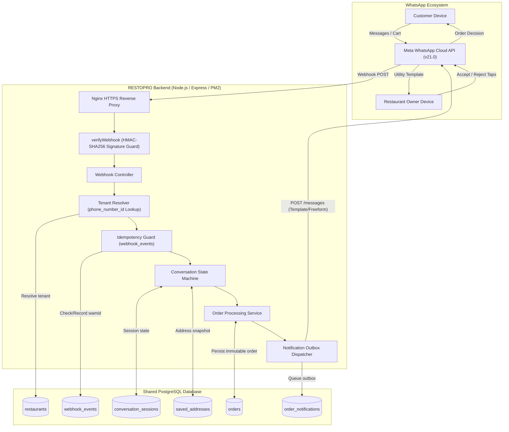

# RESTOPRO — Executive Master Plan & System Blueprint

**Document Version:** 1.0.0  
**Target Audience:** Senior Engineering Team, Technical Leads, Architects, Developers  
**Status:** Pre-Implementation Gate (Ready for Technical Approval)  

---

## 1. Executive Summary: What is RESTOPRO?

**RESTOPRO** is a high-reliability, multi-tenant WhatsApp ordering automation backend designed for independent restaurants.

Its sole purpose is to convert a restaurant's existing WhatsApp Business presence into an automated ordering counter.

### What RESTOPRO Does
- Connects to restaurant WhatsApp Business Accounts via the official Meta WhatsApp Cloud API.
- Greets customers and presents an interactive prompt to browse the restaurant's native WhatsApp catalog.
- Ingests native WhatsApp cart orders (`type: "order"`), extracts product SKUs and quantities, and calculates line totals.
- Guides customers through a deterministic checkout flow: saved address selection, new address / location pin capture, explicit address-saving consent, delivery vs. takeaway selection, and final order confirmation.
- Dispatches a single consolidated, actionable notification to the restaurant owner's WhatsApp number using a pre-approved Meta Utility Template.
- Captures the owner's Accept or Reject decision and notifies the customer immediately.
- Operates as a true multi-tenant system: a single Node.js/Express service and a single PostgreSQL database powering $N$ independent restaurants with zero cross-tenant data leakage.

### What RESTOPRO Does NOT Do
- It is **not** a menu management system (owners manage items/prices directly in Meta Commerce Manager / WhatsApp Business).
- It is **not** a POS or restaurant management system.
- It is **not** an inventory control system.
- It does **not** include a customer website, mobile app, or merchant dashboard for MVP.
- It does **not** integrate third-party payment gateways or delivery fleets for MVP.

---

## 2. Current Repository Condition (Task 1 Inspection)

Prior to this planning phase, a thorough repository inspection was conducted:
- **Repository State:** Uninitialized (no `.git` repository present).
- **Existing Files:** Exactly one file existed: `RESTOPRO_WhatsApp_Ordering_Automation_Blueprint.docx`.
- **Existing Source Code:** No Node.js source files, no `package.json`, no `prisma/schema.prisma`, no `.env` files, no tests.
- **Analysis:** Clean greenfield project state. The blueprint document provided the baseline requirements, which have now been analyzed, verified against current Meta Cloud API v21.0 specifications, and converted into an exhaustive 8-part architectural documentation suite in `docs/`.

---

## 3. Proposed Backend Architecture

---

## 4. Database Design Summary

A shared-database, shared-schema PostgreSQL design managed via Prisma ORM:
1. `restaurants`: Tenant registry, `phone_number_id` (unique tenant key), owner phone, encrypted access tokens.
2. `orders`: Immutable order records, customer snapshot, address snapshot, GPS coordinates, JSONB line items, order type (`DELIVERY`/`TAKEAWAY`), status (`PENDING_RESTAURANT_CONFIRMATION`, `ACCEPTED`, `REJECTED`, `EXPIRED`, `CANCELLED`).
3. `conversation_sessions`: Transient checkout state machine scoped by `(restaurant_id, customer_phone)`, JSONB state, 2-hour inactivity expiration.
4. `saved_addresses`: Customer address book saved strictly with explicit customer consent, scoped by `(restaurant_id, customer_phone)`.
5. `webhook_events`: Idempotency tracking table with unique constraint on Meta `event_key` (`wamid`).
6. `order_notifications`: Durable outbox queue tracking owner and customer notification dispatch with retry counts.

---

## 5. Critical Meta Integration Findings & Architectural Realities

During deep investigation of Meta WhatsApp Cloud API specifications, three pivotal technical realities were uncovered:

1. **The 24-Hour Customer Service Window on Owner Alerts:**
   - Meta strictly prevents free-form messages to numbers that have not messaged the business in 24 hours (Error 131047).
   - **Architectural Solution:** Owner notifications **must** use a pre-approved Meta Utility Template (`restopro_owner_order_alert`) containing Quick Reply buttons (`[Accept Order]`, `[Reject Order]`).
2. **Missing Product Titles in Cart Payloads:**
   - Meta incoming `type: "order"` payloads contain `product_retailer_id` (SKU), `quantity`, `item_price`, and `currency`, but omit the human-readable product name ("Chicken Biryani").
   - **Architectural Solution:** Query Meta Graph API catalog edge or maintain a cached SKU-to-Name catalog map so order summaries display readable names to customers and owners.
3. **WhatsApp Business App Coexistence:**
   - Meta officially allows Cloud API and the mobile Business App on the same number, but requires app login every 14 days and caps throughput at 5 messages/sec.
   - **Architectural Solution:** Supported for single-owner MVP, but dedicated virtual numbers are recommended for commercial high-volume restaurants.

---

## 6. Implementation Sequence & Estimated Complexity

| Stage | Title | Focus Area | Estimated Effort | Risk Level |
| :---: | :--- | :--- | :---: | :---: |
| **Stage 1** | **Meta Proof of Concept (POC)** | Live webhook verification, cart parsing, template dispatch | 2–3 Days | High |
| **Stage 2** | **Backend Foundation** | Express server, HMAC security, logging, error handling | 1–2 Days | Low |
| **Stage 3** | **Database Foundation** | PostgreSQL, Prisma schema, migrations, test seeds | 1–2 Days | Low |
| **Stage 4** | **Single Restaurant Flow** | Tenant resolution, state machine, cart, address, confirmation | 3–4 Days | Medium |
| **Stage 5** | **Owner Approval Engine** | Template dispatch, Accept/Reject handling, atomic transitions | 2–3 Days | Medium |
| **Stage 6** | **Multi-Tenant Testing** | Dual-tenant activation, cross-tenant penetration testing | 2 Days | Medium |
| **Stage 7** | **Production Hardening** | Outbox workers, session cleanup, 30-min auto-expiry | 2 Days | Low |
| **Stage 8** | **Hostinger VPS Deployment** | Nginx, SSL, PM2, live production webhook switch | 1–2 Days | Low |

---

## 7. Master Documentation Index in `docs/`

All 9 comprehensive planning artifacts have been authored and placed in the `docs/` directory:
- [00-EXECUTIVE-PLAN.md](file:///m:/For%20Other/Saeem/Only%20Whatsapp/docs/00-EXECUTIVE-PLAN.md) — Executive Master Plan & System Blueprint
- [01-PRODUCT-UNDERSTANDING.md](file:///m:/For%20Other/Saeem/Only%20Whatsapp/docs/01-PRODUCT-UNDERSTANDING.md) — Product Scope, Business Workflows & Open Decisions
- [02-BACKEND-ARCHITECTURE.md](file:///m:/For%20Other/Saeem/Only%20Whatsapp/docs/02-BACKEND-ARCHITECTURE.md) — Component Architecture, State Machines & Lifecycles
- [03-DATABASE-DESIGN.md](file:///m:/For%20Other/Saeem/Only%20Whatsapp/docs/03-DATABASE-DESIGN.md) — PostgreSQL Schema, Prisma Models, Indexes & Outbox
- [04-META-WHATSAPP-INTEGRATION.md](file:///m:/For%20Other/Saeem/Only%20Whatsapp/docs/04-META-WHATSAPP-INTEGRATION.md) — Cloud API Payloads, Catalogs, Templates & Coexistence
- [05-SECURITY-RELIABILITY.md](file:///m:/For%20Other/Saeem/Only%20Whatsapp/docs/05-SECURITY-RELIABILITY.md) — HMAC Security, Tenant Isolation, Idempotency & Outbox
- [06-IMPLEMENTATION-ROADMAP.md](file:///m:/For%20Other/Saeem/Only%20Whatsapp/docs/06-IMPLEMENTATION-ROADMAP.md) — 8-Stage Milestone Plan with Definitions of Done
- [07-IMPLEMENTATION-CHECKLIST.md](file:///m:/For%20Other/Saeem/Only%20Whatsapp/docs/07-IMPLEMENTATION-CHECKLIST.md) — Master Traceable Verification Checklist
- [08-RISKS-AND-DEPENDENCIES.md](file:///m:/For%20Other/Saeem/Only%20Whatsapp/docs/08-RISKS-AND-DEPENDENCIES.md) — Risk Matrix, Mitigation Strategies & Dependencies

---

## 8. Implementation Approval Gate & Immediate Next Action

In strict adherence to the **Implementation Approval Gate**, no application code has been written, no npm packages have been installed, and no database migrations have been executed.

### Recommended Immediate First Task (Upon Authorization):
**Stage 1: Meta Proof of Concept (POC)**
1. Initialize local Git repository (`git init`).
2. Verify Meta Developer App credentials (`META_APP_SECRET`, `META_VERIFY_TOKEN`).
3. Set up a secure HTTPS tunnel (Cloudflare Tunnel / ngrok) to capture live Meta webhook events for incoming text, catalog cart (`type: "order"`), and location payloads.

