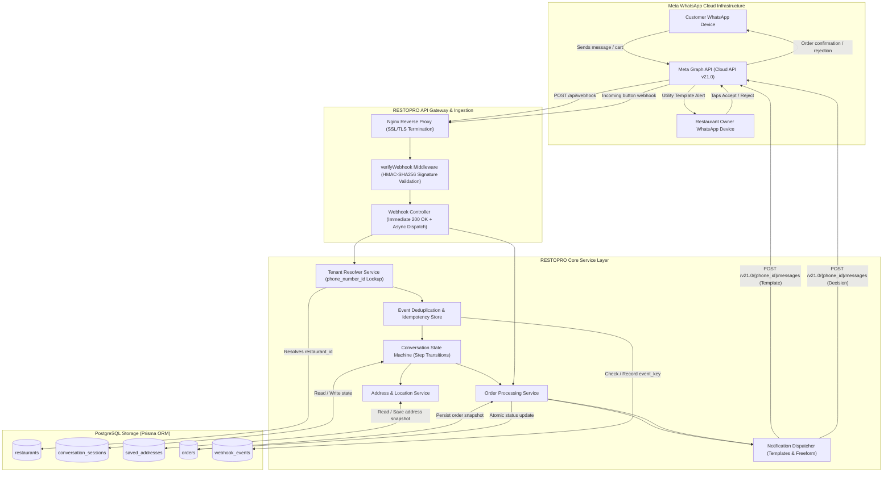
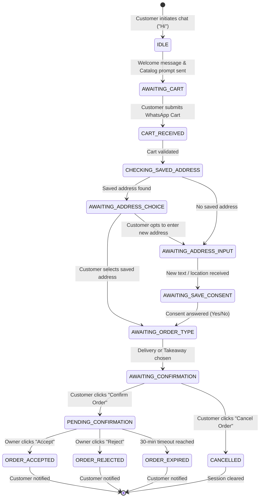
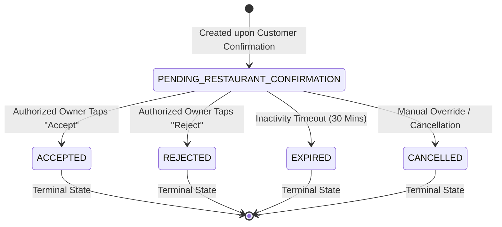

# RESTOPRO — Backend Architecture Specification

**Document Version:** 1.0.0  
**Status:** Approved for Planning / Pre-Implementation  
**Target Environment:** Node.js (LTS), Express.js, PostgreSQL 15+, Prisma ORM, Meta WhatsApp Cloud API  

---

## 1. High-Level Architectural Overview

RESTOPRO is architected as an event-driven, multi-tenant conversational ordering backend. It serves as an automated bridge between Meta’s WhatsApp Cloud API infrastructure and independent restaurant operations.

The system adheres to clean architecture principles, strictly separating:
1. **HTTP Ingestion & Verification:** Raw payload validation, signature verification, and HTTP 200 acknowledgment.
2. **Tenant Routing:** Dynamic resolution of restaurant identity based on Meta phone number metadata.
3. **Idempotency & Deduplication:** Persistence and tracking of incoming Meta webhook event IDs.
4. **State Machine / Conversation Engine:** Managing the step-by-step checkout progression per customer and restaurant.
5. **Domain Services:** Address management, cart price validation, and transactional order persistence.
6. **Outbound Notification Engine:** Guaranteed dispatch of template notifications to owners and status updates to customers.

---

## 2. End-to-End System Architecture Diagram



---

## 3. Detailed Component Responsibilities

### 3.1 Nginx Reverse Proxy
- **SSL/TLS Termination:** Manages Let’s Encrypt certificates and enforces HTTPS for Meta webhook callbacks.
- **Rate Limiting & DDOS Protection:** Shields the Node.js application from traffic spikes.
- **Reverse Proxying:** Forwards verified HTTP traffic to `http://127.0.0.1:3000`.

### 3.2 Webhook Signature Middleware (`verifyWebhook.js`)
- **GET Request Handling:** Responds to Meta’s initial Webhook Verification Challenge:
  - Validates `hub.mode === "subscribe"` and `hub.verify_token === process.env.META_VERIFY_TOKEN`.
  - Echoes back `hub.challenge` with HTTP 200.
- **POST Request HMAC Verification:**
  - Extracts `x-hub-signature-256` header from Meta request.
  - Computes `HMAC-SHA256` digest of raw incoming request buffer using `META_APP_SECRET`.
  - Performs constant-time comparison (`crypto.timingSafeEqual`) to prevent timing attacks.
  - Rejects invalid or forged payloads with HTTP 403 Forbidden.

### 3.3 Webhook Controller (`webhook.controller.js`)
- **Immediate Acknowledgment:** Responds with HTTP 200 within 2,000ms to satisfy Meta’s webhook timeout constraints.
- **Payload Parsing:** Dissects Meta’s nested `entry[].changes[].value` array.
- **Filtering:** Discards non-message events (e.g., status receipts like `sent`, `delivered`, `read`) while routing actionable messages (`text`, `order`, `location`, `button`, `interactive`) to domain services.

### 3.4 Tenant Resolver Service (`tenant.service.js`)
- **Tenant Context Discovery:** Extracts `metadata.phone_number_id` from the payload.
- **Database Lookup:** Looks up active tenant record:
  ```javascript
  const restaurant = await prisma.restaurant.findUnique({
    where: { phone_number_id: incomingPhoneNumberId }
  });
  ```
- **Tenant Scoping Guard:** If the tenant does not exist or `is_active === false`, execution halts immediately.

### 3.5 Deduplication & Idempotency Store (`webhook_events`)
- Meta provides at-least-once delivery; events can be retransmitted due to transient network blips.
- Every incoming message has a unique identifier: `wamid.HBgL...` (`message.id`).
- Before executing state logic, RESTOPRO performs an atomic insert into `webhook_events`:
  ```sql
  INSERT INTO webhook_events (restaurant_id, event_key, event_type, processing_status)
  VALUES ($1, $2, $3, 'PROCESSING')
  ON CONFLICT (event_key) DO NOTHING
  RETURNING id;
  ```
- If no row is returned, the event is a duplicate and is safely discarded.

### 3.6 Conversation Service (`conversation.service.js`)
- State machine manager for customer interactions scoped by `(restaurant_id, customer_phone)`.
- Persists progress in `conversation_sessions` table with a structured JSONB payload and an expiration timestamp (e.g., 2 hours).
- Recovers state seamlessly across server restarts or crashes.

### 3.7 Order Service (`order.service.js`)
- Validates cart line items, pricing, and currency.
- Constructs immutable order snapshots containing items, address, and coordinates.
- Manages order state transitions:
  - `PENDING_RESTAURANT_CONFIRMATION`
  - `ACCEPTED`
  - `REJECTED`
  - `EXPIRED`
  - `CANCELLED`
- Enforces single-terminal-decision constraints on owner actions.

### 3.8 Notification Service (`notification.service.js`)
- **Owner Dispatch:** Constructs Meta Utility Templates containing Quick Reply buttons (`ORDER_ACCEPT_{order_id}`, `ORDER_REJECT_{order_id}`).
- **Customer Updates:** Sends contextual customer feedback via standard interactive or text messages within the active 24-hour service window.
- **Resilience:** Implements exponential backoff retries for failed outbound API calls.

---

## 4. Conversation State Machine Lifecycle



---

## 5. Order State Machine & Transactional Lifecycle



### Invariant Rules for Order Transitions
1. **Terminal State Immutability:** Once an order reaches `ACCEPTED`, `REJECTED`, `EXPIRED`, or `CANCELLED`, its state can **never** be changed by subsequent button clicks or webhooks.
2. **Owner Identity Verification:**
   - The sender of the button click (`from`) must match the restaurant's `owner_phone`.
   - The receiving number (`phone_number_id`) must match the restaurant's `phone_number_id`.
   - The target order's `restaurant_id` must match the resolved restaurant's `id`.
3. **Atomic Execution:** Status changes are executed using Prisma transactional updates:
   ```javascript
   const updatedOrder = await prisma.order.updateMany({
     where: {
       id: orderId,
       restaurant_id: restaurant.id,
       status: "PENDING_RESTAURANT_CONFIRMATION"
     },
     data: {
       status: "ACCEPTED",
       decision_at: new Date()
     }
   });
   if (updatedOrder.count === 0) {
     // Order was already accepted, rejected, or does not exist
     return handleDuplicateOrConflictingDecision();
   }
   ```

---

## 6. Failure Modes & Operational Resilience

| Failure Scenario | Root Cause | System Response & Mitigation Strategy |
| :--- | :--- | :--- |
| **Meta Webhook Retry Storm** | Meta did not receive HTTP 200 within 20s. | Deduplication via `webhook_events` (`event_key` unique constraint). Drops duplicate immediately; returns HTTP 200. |
| **Meta Graph API Outage** | Meta API returns 500/503 or network times out. | Outbound notifications queued in database outbox table. Background worker retries with exponential backoff. Order is **never** rolled back. |
| **Server Crash during Checkout** | Hostinger VPS restarts while customer is typing address. | Session state is fully persisted in PostgreSQL `conversation_sessions`. On next customer message, bot reads state and resumes seamlessly. |
| **Owner Doesn't Respond** | Owner is asleep, busy, or offline. | Scheduled background worker checks pending orders older than 30 minutes, marks them `EXPIRED`, and sends courteous customer notification. |
| **Concurrent Customer Messages** | Customer sends multiple messages in rapid succession. | Row-level locking (`SELECT ... FOR UPDATE`) or optimistic concurrency control on `conversation_sessions` to prevent race conditions. |
| **Cross-Tenant Spoofing Attempt** | Owner A sends button payload targeting Owner B's order. | Query scopes by `restaurant_id: restaurant.id`. Cross-tenant lookup returns 0 matching rows; logged as security violation. |

