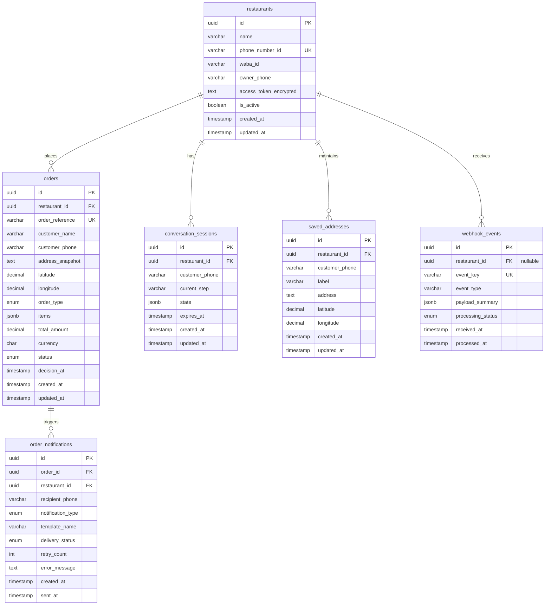

# RESTOPRO — Database Design & Data Retention Specification

**Document Version:** 1.0.0  
**Status:** Approved for Planning / Pre-Implementation  
**Database Engine:** PostgreSQL 15+  
**ORM:** Prisma ORM  

---

## 1. Database Architectural Principles

1. **Shared Database, Shared Schema:** All restaurant tenants share a single PostgreSQL database instance and identical tables.
2. **Tenant Isolation via Foreign Keys:** Every tenant-bound record contains a mandatory `restaurant_id` foreign key referencing `restaurants(id)`.
3. **Immutable Historical Snapshots:** Orders preserve exact snapshots of customer name, phone number, address text, GPS coordinates, line-item details, and prices. Mutations to saved addresses or catalog updates never retroactively affect past orders.
4. **Data Minimization:** No unnecessary tables (e.g., no generic global `customers` table for the MVP). Customer identity is captured in tenant-scoped sessions and orders.
5. **Idempotency Guarantees:** Incoming webhook messages are deduplicated via unique constraints on stable identifiers (`event_key`).

---

## 2. Complete Entity-Relationship (ER) Diagram



---

## 3. Detailed Table Specifications

### 3.1 `restaurants` (Tenant Registry)
Stores configuration, Meta credentials, and notification settings for each restaurant tenant.

| Field | Data Type | Nullable | Constraints & Defaults | Description |
| :--- | :--- | :--- | :--- | :--- |
| `id` | `UUID` | No | `PRIMARY KEY`, default `gen_random_uuid()` | Unique internal tenant identifier. |
| `name` | `VARCHAR(255)` | No | None | Restaurant commercial name (e.g., "Royal Biryani House"). |
| `phone_number_id` | `VARCHAR(64)` | No | `UNIQUE`, `INDEX` | Meta WhatsApp Cloud API Phone Number ID. |
| `waba_id` | `VARCHAR(64)` | No | None | Meta WhatsApp Business Account ID. |
| `owner_phone` | `VARCHAR(32)` | No | None | Owner WhatsApp number with country code (e.g., `+919876543210`). |
| `access_token_encrypted`| `TEXT` | No | None | AES-256-GCM encrypted Meta permanent system user access token. |
| `is_active` | `BOOLEAN` | No | Default `TRUE` | Soft switch to enable or disable restaurant automation. |
| `created_at` | `TIMESTAMPTZ`| No | Default `NOW()` | Timestamp of tenant provisioning. |
| `updated_at` | `TIMESTAMPTZ`| No | Auto-updating | Timestamp of last configuration change. |

**Indexes & Constraints:**
- `UNIQUE INDEX idx_restaurants_phone_number_id (phone_number_id)`

---

### 3.2 `orders` (Submitted Customer Orders)
Stores submitted customer orders, item snapshots, delivery addresses, and owner approval outcomes.

| Field | Data Type | Nullable | Constraints & Defaults | Description |
| :--- | :--- | :--- | :--- | :--- |
| `id` | `UUID` | No | `PRIMARY KEY`, default `gen_random_uuid()` | Internal unique primary key. |
| `restaurant_id` | `UUID` | No | `FOREIGN KEY` -> `restaurants(id)` ON DELETE RESTRICT | Owning restaurant tenant. |
| `order_reference` | `VARCHAR(32)` | No | `UNIQUE` | Human-friendly reference (e.g., `RP-1024`). |
| `customer_name` | `VARCHAR(255)` | Yes| None | WhatsApp profile name or collected name. |
| `customer_phone` | `VARCHAR(32)` | No | `INDEX` | Customer WhatsApp phone number. |
| `address_snapshot` | `TEXT` | Yes| None | Full immutable text address (null for takeaway). |
| `latitude` | `NUMERIC(10, 7)`| Yes| None | Geographic latitude coordinate (if shared). |
| `longitude` | `NUMERIC(10, 7)`| Yes| None | Geographic longitude coordinate (if shared). |
| `order_type` | `VARCHAR(16)` | No | Value: `DELIVERY` or `TAKEAWAY` | Delivery or takeaway fulfillment. |
| `items` | `JSONB` | No | None | Detailed snapshot of items, quantities, and unit prices. |
| `total_amount` | `NUMERIC(10, 2)`| No | Non-negative constraint | Calculated total amount. |
| `currency` | `CHAR(3)` | No | Default `'INR'` | ISO 4217 currency code. |
| `status` | `VARCHAR(32)` | No | Default `'PENDING_RESTAURANT_CONFIRMATION'` | Order state: `PENDING_RESTAURANT_CONFIRMATION`, `ACCEPTED`, `REJECTED`, `EXPIRED`, `CANCELLED`. |
| `decision_at` | `TIMESTAMPTZ`| Yes| None | Timestamp when owner made final Accept/Reject decision. |
| `created_at` | `TIMESTAMPTZ`| No | Default `NOW()` | Order submission timestamp. |
| `updated_at` | `TIMESTAMPTZ`| No | Auto-updating | Timestamp of last status change. |

**Indexes & Constraints:**
- `FOREIGN KEY (restaurant_id) REFERENCES restaurants(id) ON DELETE RESTRICT`
- `UNIQUE INDEX idx_orders_reference (order_reference)`
- `INDEX idx_orders_restaurant_status (restaurant_id, status)`
- `INDEX idx_orders_customer_phone (restaurant_id, customer_phone)`
- `CHECK (total_amount >= 0)`

---

### 3.3 `conversation_sessions` (Conversational State Machine)
Maintains the active checkout state of a customer conversation. Enables seamless session resumption across server reboots.

| Field | Data Type | Nullable | Constraints & Defaults | Description |
| :--- | :--- | :--- | :--- | :--- |
| `id` | `UUID` | No | `PRIMARY KEY`, default `gen_random_uuid()` | Internal unique identifier. |
| `restaurant_id` | `UUID` | No | `FOREIGN KEY` -> `restaurants(id)` ON DELETE CASCADE | Associated restaurant tenant. |
| `customer_phone` | `VARCHAR(32)` | No | None | Customer WhatsApp phone number. |
| `current_step` | `VARCHAR(64)` | No | Default `'IDLE'` | State: `IDLE`, `AWAITING_CART`, `AWAITING_ADDRESS_CHOICE`, `AWAITING_ADDRESS_INPUT`, `AWAITING_SAVE_CONSENT`, `AWAITING_ORDER_TYPE`, `AWAITING_CONFIRMATION`. |
| `state` | `JSONB` | No | Default `'{}'` | Temporary checkout cache (cart items, selected address, etc.). |
| `expires_at` | `TIMESTAMPTZ`| No | Default `NOW() + INTERVAL '2 hours'` | Inactivity expiration boundary. |
| `created_at` | `TIMESTAMPTZ`| No | Default `NOW()` | Session creation timestamp. |
| `updated_at` | `TIMESTAMPTZ`| No | Auto-updating | Last activity timestamp. |

**Indexes & Constraints:**
- `FOREIGN KEY (restaurant_id) REFERENCES restaurants(id) ON DELETE CASCADE`
- `UNIQUE INDEX idx_sessions_tenant_customer (restaurant_id, customer_phone)`
- `INDEX idx_sessions_expires_at (expires_at)`

---

### 3.4 `saved_addresses` (Consented Customer Address Book)
Stores customer delivery addresses saved with explicit customer consent.

| Field | Data Type | Nullable | Constraints & Defaults | Description |
| :--- | :--- | :--- | :--- | :--- |
| `id` | `UUID` | No | `PRIMARY KEY`, default `gen_random_uuid()` | Internal unique identifier. |
| `restaurant_id` | `UUID` | No | `FOREIGN KEY` -> `restaurants(id)` ON DELETE CASCADE | Associated restaurant tenant. |
| `customer_phone` | `VARCHAR(32)` | No | None | Customer WhatsApp phone number. |
| `label` | `VARCHAR(64)` | Yes| Default `'Default'` | Optional label (e.g., "Home", "Office"). |
| `address` | `TEXT` | No | None | Formatted text address. |
| `latitude` | `NUMERIC(10, 7)`| Yes| None | Latitude coordinate (if provided). |
| `longitude` | `NUMERIC(10, 7)`| Yes| None | Longitude coordinate (if provided). |
| `created_at` | `TIMESTAMPTZ`| No | Default `NOW()` | Consent timestamp. |
| `updated_at` | `TIMESTAMPTZ`| No | Auto-updating | Timestamp of modification. |

**Indexes & Constraints:**
- `FOREIGN KEY (restaurant_id) REFERENCES restaurants(id) ON DELETE CASCADE`
- `INDEX idx_saved_addresses_tenant_phone (restaurant_id, customer_phone)`

---

### 3.5 `webhook_events` (Idempotency & Audit Trail)
Guarantees at-most-once processing of incoming Meta webhook payloads.

| Field | Data Type | Nullable | Constraints & Defaults | Description |
| :--- | :--- | :--- | :--- | :--- |
| `id` | `UUID` | No | `PRIMARY KEY`, default `gen_random_uuid()` | Internal unique identifier. |
| `restaurant_id` | `UUID` | Yes| `FOREIGN KEY` -> `restaurants(id)` ON DELETE SET NULL | Associated restaurant (null if resolution failed). |
| `event_key` | `VARCHAR(128)`| No | `UNIQUE` | Unique Meta message identifier (`wamid.HBgL...`). |
| `event_type` | `VARCHAR(32)` | No | None | Event classification: `text`, `order`, `location`, `button`, `interactive`. |
| `payload_summary`| `JSONB` | Yes| None | Minimized audit metadata (scrubbed of PII/credentials). |
| `processing_status`| `VARCHAR(32)`| No | Default `'RECEIVED'` | Status: `RECEIVED`, `PROCESSING`, `COMPLETED`, `FAILED`, `DUPLICATE`. |
| `received_at` | `TIMESTAMPTZ`| No | Default `NOW()` | Ingestion timestamp. |
| `processed_at` | `TIMESTAMPTZ`| Yes| None | Completion timestamp. |

**Indexes & Constraints:**
- `UNIQUE INDEX idx_webhook_events_key (event_key)`
- `INDEX idx_webhook_events_status (processing_status)`

---

### 3.6 `order_notifications` (Durable Notification Outbox)
Provides durable delivery tracking for owner notifications and customer status updates.

| Field | Data Type | Nullable | Constraints & Defaults | Description |
| :--- | :--- | :--- | :--- | :--- |
| `id` | `UUID` | No | `PRIMARY KEY`, default `gen_random_uuid()` | Unique primary key. |
| `order_id` | `UUID` | No | `FOREIGN KEY` -> `orders(id)` ON DELETE CASCADE | Associated order. |
| `restaurant_id` | `UUID` | No | `FOREIGN KEY` -> `restaurants(id)` ON DELETE CASCADE | Associated tenant. |
| `recipient_phone`| `VARCHAR(32)` | No | None | Target phone number (owner or customer). |
| `notification_type`| `VARCHAR(32)`| No | None | `OWNER_ALERT`, `CUSTOMER_ACCEPTED`, `CUSTOMER_REJECTED`, `CUSTOMER_EXPIRED`. |
| `template_name` | `VARCHAR(64)` | Yes| None | Meta Template name (for business-initiated messages). |
| `delivery_status`| `VARCHAR(32)`| No | Default `'PENDING'` | `PENDING`, `SENT`, `FAILED`. |
| `retry_count` | `INT` | No | Default `0` | Number of dispatch attempts. |
| `error_message` | `TEXT` | Yes| None | Meta API error code and message if failed. |
| `created_at` | `TIMESTAMPTZ`| No | Default `NOW()` | Queue timestamp. |
| `sent_at` | `TIMESTAMPTZ`| Yes| None | Successful delivery timestamp. |

**Indexes & Constraints:**
- `INDEX idx_order_notifs_pending (delivery_status, retry_count)`

---

## 4. Prisma Schema Definition (`prisma/schema.prisma`)

```prisma
datasource db {
  provider = "postgresql"
  url      = env("DATABASE_URL")
}

generator client {
  provider = "prisma-client-js"
}

enum OrderType {
  DELIVERY
  TAKEAWAY
}

enum OrderStatus {
  PENDING_RESTAURANT_CONFIRMATION
  ACCEPTED
  REJECTED
  EXPIRED
  CANCELLED
}

enum WebhookStatus {
  RECEIVED
  PROCESSING
  COMPLETED
  FAILED
  DUPLICATE
}

enum NotificationStatus {
  PENDING
  SENT
  FAILED
}

model Restaurant {
  id                     String                @id @default(uuid()) @db.Uuid
  name                   String                @db.VarChar(255)
  phone_number_id        String                @unique @db.VarChar(64)
  waba_id                String                @db.VarChar(64)
  owner_phone            String                @db.VarChar(32)
  access_token_encrypted String                @db.Text
  is_active              Boolean               @default(true)
  created_at             DateTime              @default(now()) @db.Timestamptz()
  updated_at             DateTime              @updatedAt @db.Timestamptz()

  orders                 Order[]
  sessions               ConversationSession[]
  saved_addresses        SavedAddress[]
  webhook_events         WebhookEvent[]
  notifications          OrderNotification[]

  @@map("restaurants")
}

model Order {
  id               String              @id @default(uuid()) @db.Uuid
  restaurant_id    String              @db.Uuid
  order_reference  String              @unique @db.VarChar(32)
  customer_name    String?             @db.VarChar(255)
  customer_phone   String              @db.VarChar(32)
  address_snapshot String?             @db.Text
  latitude         Decimal?            @db.Decimal(10, 7)
  longitude        Decimal?            @db.Decimal(10, 7)
  order_type       OrderType
  items            Json                @db.JsonB
  total_amount     Decimal             @db.Decimal(10, 2)
  currency         String              @default("INR") @db.Char(3)
  status           OrderStatus         @default(PENDING_RESTAURANT_CONFIRMATION)
  decision_at      DateTime?           @db.Timestamptz()
  created_at       DateTime            @default(now()) @db.Timestamptz()
  updated_at       DateTime            @updatedAt @db.Timestamptz()

  restaurant       Restaurant          @relation(fields: [restaurant_id], references: [id], onDelete: Restrict)
  notifications    OrderNotification[]

  @@index([restaurant_id, status])
  @@index([restaurant_id, customer_phone])
  @@map("orders")
}

model ConversationSession {
  id             String     @id @default(uuid()) @db.Uuid
  restaurant_id  String     @db.Uuid
  customer_phone String     @db.VarChar(32)
  current_step   String     @default("IDLE") @db.VarChar(64)
  state          Json       @default("{}") @db.JsonB
  expires_at     DateTime   @db.Timestamptz()
  created_at     DateTime   @default(now()) @db.Timestamptz()
  updated_at     DateTime   @updatedAt @db.Timestamptz()

  restaurant     Restaurant @relation(fields: [restaurant_id], references: [id], onDelete: Cascade)

  @@unique([restaurant_id, customer_phone])
  @@index([expires_at])
  @@map("conversation_sessions")
}

model SavedAddress {
  id             String     @id @default(uuid()) @db.Uuid
  restaurant_id  String     @db.Uuid
  customer_phone String     @db.VarChar(32)
  label          String?    @default("Default") @db.VarChar(64)
  address        String     @db.Text
  latitude       Decimal?   @db.Decimal(10, 7)
  longitude      Decimal?   @db.Decimal(10, 7)
  created_at     DateTime   @default(now()) @db.Timestamptz()
  updated_at     DateTime   @updatedAt @db.Timestamptz()

  restaurant     Restaurant @relation(fields: [restaurant_id], references: [id], onDelete: Cascade)

  @@index([restaurant_id, customer_phone])
  @@map("saved_addresses")
}

model WebhookEvent {
  id               String        @id @default(uuid()) @db.Uuid
  restaurant_id    String?       @db.Uuid
  event_key        String        @unique @db.VarChar(128)
  event_type       String        @db.VarChar(32)
  payload_summary  Json?         @db.JsonB
  processing_status WebhookStatus @default(RECEIVED)
  received_at      DateTime      @default(now()) @db.Timestamptz()
  processed_at     DateTime?     @db.Timestamptz()

  restaurant       Restaurant?   @relation(fields: [restaurant_id], references: [id], onDelete: SetNull)

  @@index([processing_status])
  @@map("webhook_events")
}

model OrderNotification {
  id                String             @id @default(uuid()) @db.Uuid
  order_id          String             @db.Uuid
  restaurant_id     String             @db.Uuid
  recipient_phone   String             @db.VarChar(32)
  notification_type String             @db.VarChar(32)
  template_name     String?            @db.VarChar(64)
  delivery_status   NotificationStatus @default(PENDING)
  retry_count       Int                @default(0)
  error_message     String?            @db.Text
  created_at        DateTime           @default(now()) @db.Timestamptz()
  sent_at           DateTime?          @db.Timestamptz()

  order             Order              @relation(fields: [order_id], references: [id], onDelete: Cascade)
  restaurant        Restaurant         @relation(fields: [restaurant_id], references: [id], onDelete: Cascade)

  @@index([delivery_status, retry_count])
  @@map("order_notifications")
}
```

---

## 5. Structural Sample Payloads

### 5.1 Structure of `orders.items` (JSONB)
```json
[
  {
    "product_retailer_id": "SKU_CHKN_BIRYANI_01",
    "name": "Chicken Biryani Special",
    "quantity": 2,
    "unit_price": 240.00,
    "line_total": 480.00,
    "currency": "INR"
  },
  {
    "product_retailer_id": "SKU_COLD_COFFEE_04",
    "name": "Iced Cold Coffee",
    "quantity": 1,
    "unit_price": 80.00,
    "line_total": 80.00,
    "currency": "INR"
  }
]
```

### 5.2 Structure of `conversation_sessions.state` (JSONB)
```json
{
  "cart": {
    "catalog_id": "987654321098765",
    "items": [
      {
        "product_retailer_id": "SKU_CHKN_BIRYANI_01",
        "quantity": 2,
        "item_price": 240.00,
        "currency": "INR"
      }
    ],
    "subtotal": 480.00
  },
  "address": {
    "text": "Flat 302, Green Valley Apts, Andheri West, Mumbai",
    "latitude": 19.1363257,
    "longitude": 72.8276601,
    "is_saved": false
  },
  "order_type": "DELIVERY",
  "generated_order_ref": "RP-1024"
}
```

---

## 6. Transaction Boundaries & Concurrency

### Order Creation Transaction Boundary
Creating an order requires atomic execution across three operations:
```javascript
await prisma.$transaction(async (tx) => {
  // 1. Create Order Record
  const newOrder = await tx.order.create({
    data: {
      restaurant_id: tenantId,
      order_reference: generateOrderRef(),
      customer_name: session.state.customer_name,
      customer_phone: customerPhone,
      address_snapshot: session.state.address?.text || null,
      latitude: session.state.address?.latitude || null,
      longitude: session.state.address?.longitude || null,
      order_type: session.state.order_type,
      items: session.state.cart.items,
      total_amount: session.state.cart.subtotal,
      currency: "INR",
      status: "PENDING_RESTAURANT_CONFIRMATION"
    }
  });

  // 2. Queue Durable Owner Notification
  await tx.orderNotification.create({
    data: {
      order_id: newOrder.id,
      restaurant_id: tenantId,
      recipient_phone: restaurant.owner_phone,
      notification_type: "OWNER_ALERT",
      template_name: "restopro_owner_order_alert",
      delivery_status: "PENDING"
    }
  });

  // 3. Advance Conversation Session
  await tx.conversationSession.update({
    where: {
      restaurant_id_customer_phone: {
        restaurant_id: tenantId,
        customer_phone: customerPhone
      }
    },
    data: {
      current_step: "AWAITING_OWNER_DECISION",
      state: { ...session.state, active_order_id: newOrder.id }
    }
  });
});
```

---

## 7. Migration & Data Retention Strategy

1. **Migration Tooling:** Managed via standard `npx prisma migrate dev` in local environments and `npx prisma migrate deploy` in CI/VPS deployment.
2. **Session Cleanup Policy:** Sessions older than `expires_at` are purged periodically (e.g., daily cron: `DELETE FROM conversation_sessions WHERE expires_at < NOW()`).
3. **Webhook Audit Cleanup:** Completed `webhook_events` are purged after 30 days to keep table bloat low.
4. **Order History Retention:** Orders are retained permanently for financial accounting, or archived to cold storage after 180 days.

