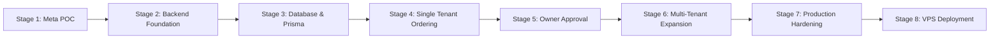

# RESTOPRO — Implementation Roadmap

**Document Version:** 1.0.0  
**Status:** Approved for Planning / Pre-Implementation  
**Target Architecture:** Multi-Tenant Node.js / Express / PostgreSQL / Meta WhatsApp Cloud API  

---

## Roadmap Overview

The implementation of RESTOPRO is structured into **8 sequential stages**. Each stage has clear dependencies, distinct files affected, strict acceptance criteria, and an unambiguous Definition of Done.

---

## Stage 1 — Meta Proof of Concept (POC)

### Objective
Verify the real-world Meta WhatsApp Cloud API behavior, capture live incoming webhook payloads for text, native catalog cart, location, and button replies, and confirm that our planned architecture aligns with Meta's actual API constraints.

### Tasks
1. Set up a Meta Developer App, test WhatsApp Business Account (WABA), and test phone number.
2. Configure webhook callback URL using a temporary secure tunnel (ngrok or cloudflare tunnel).
3. Test webhook challenge verification (`hub.challenge`).
4. Receive a standard greeting message ("Hi").
5. Link a test catalog in Meta Commerce Manager and send an interactive `catalog_message`.
6. Add items to cart in WhatsApp and submit the cart; inspect the incoming `type: "order"` webhook.
7. Send a GPS location pin from WhatsApp; inspect `type: "location"` webhook.
8. Test outgoing message template with Quick Reply buttons to owner phone number.

### Dependencies
- Meta Developer Account, Facebook Business Manager access, test mobile device with WhatsApp.

### Files Affected
- `test/poc/webhook-logger.js` (temporary scratch script for live payload capture)
- `docs/04-META-WHATSAPP-INTEGRATION.md` (updated with verified payload samples)

### Database Changes
- None (scratch verification only).

### Risks
- Delays in Meta Business Manager phone number verification.
- Coexistence sync delays if using an active WhatsApp Business App number.

### Test Cases
- `TC01`, `TC02`, `TC03`, `TC09`

### Acceptance Criteria & Definition of Done
- A real test cart submission from WhatsApp reaches the backend.
- The exact JSON payload is logged and documented.
- Outbound template message successfully reaches the test owner device.

---

## Stage 2 — Backend Foundation

### Objective
Build the clean Express.js server scaffolding, environment configuration, HMAC-SHA256 signature verification middleware, structured logging, and health monitoring endpoints.

### Tasks
1. Initialize `package.json` with agreed dependencies: `express`, `dotenv`, `axios`, `@prisma/client`, `nodemon`, `prisma`.
2. Implement `.env` and `.env.example` configurations.
3. Configure raw body buffer parsing in `src/app.js`.
4. Implement `src/middleware/verifyWebhook.js` for GET challenge and POST HMAC signature verification.
5. Implement `GET /health` and `POST /api/webhook` routes.
6. Build structured logger utility in `src/utils/logger.js`.

### Dependencies
- Stage 1 completed.

### Files Affected
- `package.json`
- `.env.example`
- `src/app.js`
- `src/server.js`
- `src/routes/webhook.routes.js`
- `src/controllers/webhook.controller.js`
- `src/middleware/verifyWebhook.js`
- `src/utils/logger.js`

### Database Changes
- None.

### Risks
- Misconfigured body parsers altering raw buffers, causing signature verification failures.

### Test Cases
- Invalid HMAC signature rejected with HTTP 403.
- Valid HMAC signature accepted with HTTP 200.
- Health endpoint returns operational status.

### Definition of Done
- Server runs locally, validates incoming signatures, logs structured JSON, and responds to Meta verification challenges.

---

## Stage 3 — Database Foundation & Prisma Schema

### Objective
Provision the PostgreSQL database, configure Prisma ORM, execute the initial migration, establish all foreign keys and constraints, and seed test restaurant tenant records.

### Tasks
1. Configure `prisma/schema.prisma` with models: `Restaurant`, `Order`, `ConversationSession`, `SavedAddress`, `WebhookEvent`, `OrderNotification`.
2. Generate and apply initial Prisma migration: `npx prisma migrate dev --name init_restopro_schema`.
3. Create database client singleton in `src/config/database.js`.
4. Create test seed script `prisma/seed.js` provisioning Test Restaurant A (`phone_number_id: 111111`) and Test Restaurant B (`phone_number_id: 222222`).
5. Verify unique constraints and cascade deletion behaviors.

### Dependencies
- Stage 2 completed, local PostgreSQL instance running.

### Files Affected
- `prisma/schema.prisma`
- `prisma/migrations/*`
- `prisma/seed.js`
- `src/config/database.js`

### Database Changes
- Tables created: `restaurants`, `orders`, `conversation_sessions`, `saved_addresses`, `webhook_events`, `order_notifications`.

### Risks
- PostgreSQL connection pool exhaustion under load.

### Test Cases
- Migrations apply cleanly without errors.
- Seed script successfully inserts test restaurants.
- Foreign key and unique constraints trigger expected exceptions on invalid inserts.

### Definition of Done
- Prisma Client connects, database schema is fully migrated, and test tenants are seeded.

---

## Stage 4 — Single Restaurant Customer Ordering Engine

### Objective
Implement the complete conversational ordering engine for a single restaurant tenant, from initial greeting, catalog cart handling, address collection, consent capture, to order confirmation.

### Tasks
1. Build `src/services/tenant.service.js` to resolve tenant from `phone_number_id`.
2. Implement idempotency checking in `src/services/webhook.service.js` using `webhook_events`.
3. Build `src/services/conversation.service.js` implementing state transitions:
   - Greeting ("Hi") -> Welcome message + Catalog prompt.
   - Native cart (`order`) -> Validate items, calculate total -> `CART_RECEIVED`.
   - Address lookup -> Offer saved address OR prompt for new text / location.
   - Address consent -> Ask Yes/No to save; persist to `saved_addresses` only on Yes.
   - Order type -> Select Delivery vs. Takeaway.
   - Order review -> Display formatted summary with Confirm/Cancel buttons.
   - Confirmation -> Persist order to `orders` table with status `PENDING_RESTAURANT_CONFIRMATION`.
4. Build `src/services/whatsapp.service.js` to dispatch text and interactive messages.
5. Build `src/utils/order-formatter.js` to format readable WhatsApp summaries.

### Dependencies
- Stage 3 completed.

### Files Affected
- `src/controllers/webhook.controller.js`
- `src/services/tenant.service.js`
- `src/services/conversation.service.js`
- `src/services/address.service.js`
- `src/services/order.service.js`
- `src/services/whatsapp.service.js`
- `src/utils/order-formatter.js`

### Database Changes
- None (uses schema from Stage 3).

### Risks
- State corruption if customer sends out-of-order messages.
- Discrepancy between cart currency and restaurant configuration.

### Test Cases
- `TC01` through `TC12`, `TC34`.

### Definition of Done
- A customer can complete the full checkout flow end-to-end, resulting in exactly one persisted order record with status `PENDING_RESTAURANT_CONFIRMATION`.

---

## Stage 5 — Owner Notification & Decision Processing

### Objective
Implement consolidated owner notifications via Meta Utility Templates, process owner Accept/Reject button clicks, enforce single terminal decisions, and deliver immediate customer status updates.

### Tasks
1. Register and approve Meta Utility Message Template (`restopro_owner_order_alert`) with Quick Reply buttons `[Accept Order]` and `[Reject Order]`.
2. Build `src/services/notification.service.js` to queue and dispatch owner template alerts.
3. Handle incoming owner webhook:
   - Identify sender phone number.
   - Verify sender is authorized owner (`owner_phone`).
   - Extract order reference from button payload (`ORDER_ACCEPT_RP1024` / `ORDER_REJECT_RP1024`).
   - Verify order belongs to the restaurant.
   - Execute atomic transition from `PENDING_RESTAURANT_CONFIRMATION` to `ACCEPTED` or `REJECTED`.
4. Dispatch customer notification message informing them of the owner's decision.
5. Implement duplicate decision guard (ignore subsequent clicks if order is already resolved).

### Dependencies
- Stage 4 completed.

### Files Affected
- `src/services/notification.service.js`
- `src/services/order.service.js`
- `src/controllers/webhook.controller.js`

### Database Changes
- None.

### Risks
- Owner receiving alerts outside the 24-hour window failing if templates are not approved.
- Concurrency race conditions if two managers tap buttons simultaneously.

### Test Cases
- `TC13` through `TC17`, `TC19`, `TC20`.

### Definition of Done
- An owner receives an order alert on WhatsApp, taps Accept or Reject, the order status updates atomically in PostgreSQL, and the customer receives the confirmation update.

---

## Stage 6 — Multi-Tenant Verification & Security Testing

### Objective
Activate multiple restaurant tenants simultaneously, proving strict data isolation, zero cross-tenant leakage, independent address books, and concurrent order processing.

### Tasks
1. Seed second restaurant (Restaurant B: `name: "Sushi Express"`, `phone_number_id: "222222"`, `owner_phone: "+919811122244"`).
2. Execute automated integration tests simulating concurrent orders for Restaurant A and Restaurant B.
3. Test cross-tenant attack scenarios:
   - Owner A attempts to accept Restaurant B's order.
   - Customer at Restaurant B attempts to access Restaurant A's saved address.
   - Sending payloads with spoofed tenant IDs.
4. Verify tenant soft-disable switch (`is_active = false`).

### Dependencies
- Stage 5 completed.

### Files Affected
- `test/integration/multi-tenant.test.js`
- `src/services/tenant.service.js`

### Database Changes
- None.

### Risks
- Un-scoped database queries accidentally exposing cross-tenant records.

### Test Cases
- `TC21` through `TC26`, `TC28`, `TC35`.

### Definition of Done
- Two restaurants handle orders concurrently without cross-contamination. Security tests prove cross-tenant actions are strictly denied.

---

## Stage 7 — Production Hardening & Reliability

### Objective
Harden the backend for production: implement durable outbox retries, automated session expiration cleanup, rate limiting, and failure recovery.

### Tasks
1. Implement durable notification outbox worker (`src/jobs/notification-worker.js`) with exponential backoff.
2. Implement automated session expiration cron job (`src/jobs/session-cleanup.js`).
3. Implement 30-minute owner non-response auto-expiry job (`src/jobs/order-timeout.js`).
4. Conduct load testing and simulate transient database/network outages.
5. Configure automated database backups script (`scripts/backup-db.sh`).

### Dependencies
- Stage 6 completed.

### Files Affected
- `src/jobs/notification-worker.js`
- `src/jobs/session-cleanup.js`
- `src/jobs/order-timeout.js`
- `scripts/backup-db.sh`

### Database Changes
- None.

### Risks
- Background worker crashing the main event loop if unhandled promise rejections occur.

### Test Cases
- `TC27`, `TC30`, `TC31`, `TC32`, `TC33`.

### Definition of Done
- System automatically cleans up stale sessions, marks unhandled orders as expired after 30 minutes, retries failed Meta notifications durably, and recovers from crashes without data loss.

---

## Stage 8 — Hostinger VPS Deployment

### Objective
Deploy the hardened RESTOPRO backend to Hostinger VPS with Nginx HTTPS reverse proxy, PM2 process management, and production PostgreSQL.

### Tasks
1. Provision Hostinger Ubuntu VPS with Node.js LTS, PostgreSQL 15, and PM2.
2. Configure production PostgreSQL database, users, and connection string.
3. Clone repository, install production dependencies, and run Prisma migrations.
4. Configure Nginx reverse proxy with Let's Encrypt SSL certificate (`certbot`).
5. Set up PM2 cluster mode with ecosystem file (`ecosystem.config.js`).
6. Configure production environment variables in `.env`.
7. Configure Meta App Webhook URL to production HTTPS domain and verify live webhook challenge.
8. Perform smoke test with live restaurant order.

### Dependencies
- Stage 7 completed, Hostinger VPS access, Domain name configured with DNS records.

### Files Affected
- `ecosystem.config.js`
- `nginx/restopro.conf`

### Database Changes
- Production PostgreSQL migrated.

### Risks
- Firewall / port blocking on VPS (ports 80, 443).
- SSL certificate renewal failures.

### Test Cases
- Production health check `GET https://api.restopro.app/health`.
- Production webhook challenge verification.
- Live end-to-end order test.

### Definition of Done
- RESTOPRO is live on Hostinger VPS, secured by HTTPS, managed by PM2, connected to production PostgreSQL, and successfully processing live WhatsApp orders.

