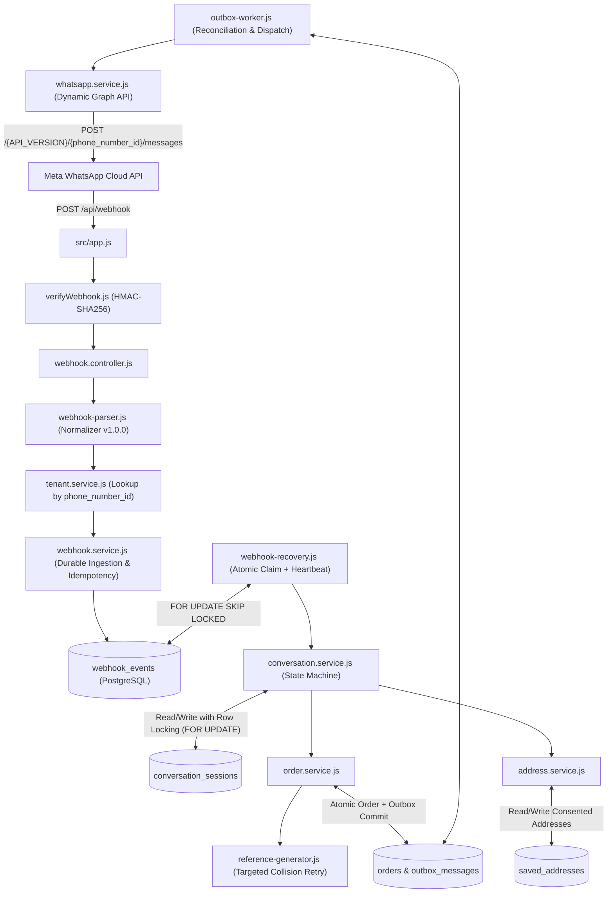

# RESTOPRO — Stage 4: Technical Architecture & System Design

**Document Version:** 2.3.0  
**Status:** Approved for Implementation Planning / Pre-Code Gate  
**Target Engine:** Node.js / Express / PostgreSQL 15+ / Prisma v6 / Meta Graph API (Centrally Configurable)  

---

## 1. System Component Topology



---

## 2. Webhook Recovery Leases & Distributed Worker Claiming

RESTOPRO decouples incoming webhook acknowledgment from downstream business processing to prevent event loss, timeouts, and duplicate orders:

```
┌────────────────────────────────────────────────────────────────────────┐
│               FOUR-STAGE WEBHOOK PROCESSING PIPELINE                  │
├──────────────┬──────────────────┬─────────────────┬────────────────────┤
│ Stage        │ Trigger / Timing │ Database Status │ Error Recovery     │
├──────────────┼──────────────────┼─────────────────┼────────────────────┤
│ 1. Persist   │ Sync (Pre-Ack)   │ RECEIVED        │ Return HTTP 500    │
│ 2. Acknowledge│ Immediate (<2s) │ RECEIVED        │ None (Meta Acked)  │
│ 3. Claim&Exec│ Async / Worker   │ PROCESSING      │ Lease Heartbeat/CAS│
│ 4. Dispatch  │ Post-Process     │ COMPLETED       │ Outbox Reconcile   │
└──────────────┴──────────────────┴─────────────────┴────────────────────┘
```

### 2.1 The Distributed Lease Problem & Explicit Schema Fields
Relying on an ambiguous `processed_at` timestamp leads to race conditions where slow workers get reclaimed while still executing, causing duplicate execution or state corruption.

> [!NOTE]
> **Proposed Prerequisite Schema Enhancement (Requires Explicit User Approval):**
> Model `WebhookEvent` requires four dedicated lease tracking fields:
> ```prisma
> claimed_by       String?   @db.VarChar(64)      // Worker instance identifier (e.g. worker-pm2-1)
> lease_token      String?   @db.Uuid             // Unique cryptographic fencing token generated per claim
> lease_expires_at DateTime? @db.Timestamptz      // Absolute timestamp when lease expires
> attempt_count    Int       @default(0)          // Bounded retry tracking
> ```

### 2.2 Atomic Event Claiming Transaction
Workers acquire uncompleted events using an atomic single-statement update with row-level locking. The `FOR UPDATE SKIP LOCKED` clause ensures that across multiple PM2 worker processes, each event is claimed exclusively by exactly one worker without lock contention or duplicate execution:

```sql
UPDATE webhook_events
SET processing_status = 'PROCESSING',
    claimed_by = $worker_id,
    lease_token = gen_random_uuid(),
    lease_expires_at = NOW() + INTERVAL '2 minutes',
    attempt_count = attempt_count + 1
WHERE id IN (
    SELECT id FROM webhook_events 
    WHERE (processing_status = 'RECEIVED' AND received_at < NOW() - INTERVAL '15 seconds')
       OR (processing_status = 'PROCESSING' AND lease_expires_at < NOW())
    ORDER BY received_at ASC 
    LIMIT 25 
    FOR UPDATE SKIP LOCKED
)
RETURNING id, event_key, restaurant_id, payload_summary, lease_token;
```

### 2.3 Lease Expiration and Heartbeat Renewal
* **Lease Duration:** Default lease TTL is **120 seconds** (`INTERVAL '2 minutes'`).
* **Heartbeat Keepalive:** For long-running operations (e.g. high-latency database queries), the worker issues a heartbeat renewal every 30 seconds:
  ```sql
  UPDATE webhook_events
  SET lease_expires_at = NOW() + INTERVAL '2 minutes'
  WHERE id = $id AND lease_token = $lease_token AND processing_status = 'PROCESSING';
  ```
* **Preventing Concurrent Reclamation of Live Workers:** As long as a worker is alive and heartbeating, `lease_expires_at` remains in the future. The query condition `lease_expires_at < NOW()` is never met, strictly preventing any secondary worker from stealing or reclaiming the event while the primary worker is actively processing.

### 2.4 Ownership-Token Validation Before Committing (Fencing Token / CAS)
* When a worker completes business logic, it commits completion using Compare-And-Swap (CAS) guarded by its unique `lease_token`:
  ```sql
  UPDATE webhook_events
  SET processing_status = 'COMPLETED',
      processed_at = NOW(),
      claimed_by = NULL,
      lease_token = NULL,
      lease_expires_at = NULL
  WHERE id = $id AND lease_token = $lease_token;
  ```
* **Stale Worker Defense:** If the worker experienced a deep pause or network partition exceeding 2 minutes without a heartbeat, another worker may have reclaimed the event. In this scenario, the CAS statement matches zero rows (`rowCount === 0`). The worker detects that its lease was revoked and **aborts its commit**, preventing stale results from corrupting newer state.

### 2.5 Failure Classification & Bounded Retries
* **Retryable Failures:** Transient database connection failures, lock contention (`P2034`), network timeouts.
  * Re-queued with exponential backoff ($2^{\text{attempt}} \times 5$ seconds) up to a maximum of 3 attempts (`attempt_count <= 3`).
* **Permanent Failures:** Malformed JSON, schema violations, invalid cart items, unmapped tenant phone numbers, or exhausted retries (`attempt_count > 3`).
  * Immediately transitioned to `processing_status = 'FAILED'`, capturing error details in `payload_summary.error`. Never re-queued.

---

## 3. WhatsApp Outbound Delivery Semantics & Uncertain Outcomes

### 3.1 Reality of Meta WhatsApp Cloud API Idempotency
> [!IMPORTANT]
> **API Limitation Finding:**
> Unlike payment gateways (e.g. Stripe `Idempotency-Key`), **Meta WhatsApp Cloud API's `POST /{phone_number_id}/messages` endpoint DOES NOT support client-generated idempotency headers or payload tokens.**
> Sending an identical HTTP POST request twice to Meta **will cause Meta to deliver two separate WhatsApp messages to the customer's phone.**
> RESTOPRO therefore cannot rely on Meta API headers to deduplicate outbound messages.

### 3.2 Outbound Delivery State Model
The Transactional Outbox tracks outbound message states explicitly:

```
[PENDING] ──(HTTP POST)──► [ACCEPTED] (HTTP 200 with wamid) ──(Webhook Status)──► [DELIVERED] ──► [READ]
    │                           │
    │ (Network Timeout / 504)   └─(Webhook Failure)─► [FAILED_DELIVERY]
    ▼
[UNCERTAIN_DISPATCH] ──(Reconciled via incoming status wamid)──► [DELIVERED]
    │
    ├──(Customer activity observed in session)──► [SUPPRESSED_BY_CUSTOMER_ACTIVITY]
    │
    └──(Grace period expires: 60s)──► [RETRY_DISPATCH] (Max 1 bounded retry) ──► [FAILED]
```

### 3.3 Categorization of Dispatch Outcomes
1. **Confirmed API Acceptance (HTTP 200):**
   * Meta accepted the request into its queuing system.
   * Response contains `{ "messaging_product": "whatsapp", "messages": [{ "id": "wamid.HBgM..." }] }`.
   * Outbox updates `meta_message_id = wamid.HBgM...` and `delivery_status = 'ACCEPTED'`.
2. **Confirmed Permanent Failure (HTTP 4xx):**
   * Client-side errors (e.g., 24-hour customer service window expired, invalid recipient number).
   * Transition to `delivery_status = 'FAILED'` with `error_message`. Never retried.
3. **Confirmed Retryable Failure (HTTP 500 / 503):**
   * Server-side Meta error where Meta returned an explicit error response indicating the message was **not** accepted.
   * Transition to `PENDING` with exponential backoff retry.
4. **Uncertain Outcome (Network Timeout / Socket Drop / HTTP 504):**
   * The HTTP connection was severed after RESTOPRO transmitted request bytes, but before the HTTP response headers were received.
   * Meta **may or may not** have received and dispatched the message.

### 3.4 Handling Uncertain Outcomes (The Reconciliation Strategy)
When an outbound request encounters an uncertain outcome:
1. **Never Blind-Retry Immediately:** Blindly re-sending the message risks sending duplicate receipts to the customer.
2. **Mark Status `UNCERTAIN_DISPATCH`:** Outbox record transitions to `delivery_status = 'UNCERTAIN_DISPATCH'` with `last_attempt_at = NOW()`.
3. **Status Webhook Reconciliation Window (60 Seconds):**
   * If Meta actually received the message, it will emit a webhook status receipt (`sent` / `delivered`) containing recipient phone number and timestamp within 15–30 seconds.
   * When an incoming status webhook arrives matching the recipient and approximate timestamp, RESTOPRO reconciles the message, links the `meta_message_id`, and marks it `DELIVERED`.
4. **Customer Activity Suppression:**
   * If the customer sends another message or taps a button before the retry triggers, they clearly received the message or have moved on. The retry is marked `SUPPRESSED_BY_CUSTOMER_ACTIVITY` to avoid annoying the user.
5. **Bounded Single Fallback Retry:**
   * Only for critical order submission receipts: If after a 60-second reconciliation window no status receipt and no customer activity has occurred, exactly **one** fallback retry is dispatched (`attempt_count = 2`). If that attempt also fails, status transitions to `FAILED` for operational inspection.

### 3.5 Proposed Outbox Schema Prerequisite: `outbox_messages`
> [!NOTE]
> **Proposed Schema Migration (Requires Explicit User Approval):**
> Model `OutboxMessage` provides the database backing for transactional delivery:
> ```prisma
> model OutboxMessage {
>   id              String    @id @default(uuid()) @db.Uuid
>   restaurant_id   String    @db.Uuid
>   recipient_phone String    @db.VarChar(32)
>   message_type    String    @db.VarChar(32)
>   payload         Json      @db.JsonB
>   delivery_status String    @default("PENDING") @db.VarChar(32) // PENDING, ACCEPTED, UNCERTAIN_DISPATCH, DELIVERED, READ, FAILED, SUPPRESSED
>   retry_count     Int       @default(0)
>   idempotency_key String    @unique @db.VarChar(128)
>   meta_message_id String?   @db.VarChar(128)
>   error_message   String?   @db.Text
>   created_at      DateTime  @default(now()) @db.Timestamptz()
>   last_attempt_at DateTime? @db.Timestamptz()
>   sent_at         DateTime? @db.Timestamptz()
> 
>   restaurant Restaurant @relation(fields: [restaurant_id], references: [id], onDelete: Cascade)
>   @@index([delivery_status, retry_count])
>   @@map("outbox_messages")
> }
> ```

---

## 4. Webhook Event Replay Contract & Normalization (v1.0.0)

### 4.1 Versioned Normalized Event Envelope
To guarantee complete event reconstruction without storing raw HTTP buffers, all webhook events are parsed into a normalized schema persisted in `webhook_events.payload_summary`:

```json
{
  "schema_version": "1.0.0",
  "event_type": "TEXT | ORDER | INTERACTIVE_BUTTON | INTERACTIVE_LIST | LOCATION | STATUS",
  "wamid": "wamid.HBgM...",
  "phone_number_id": "100609346452123",
  "customer_phone": "919876543210",
  "timestamp": 1793886890,
  "data": { ... }
}
```

### 4.2 Schema Definitions by Event Type

#### 1. TEXT (Greetings & Free-Form Addresses)
```json
{
  "schema_version": "1.0.0",
  "event_type": "TEXT",
  "wamid": "wamid.HBgM...",
  "phone_number_id": "100609346452123",
  "customer_phone": "919876543210",
  "timestamp": 1793886890,
  "data": {
    "text": "Flat 302, Green Valley Apartments, Andheri West, Mumbai"
  }
}
```

#### 2. ORDER (Native WhatsApp Catalog Cart)
```json
{
  "schema_version": "1.0.0",
  "event_type": "ORDER",
  "wamid": "wamid.HBgM...",
  "phone_number_id": "100609346452123",
  "customer_phone": "919876543210",
  "timestamp": 1793886890,
  "data": {
    "catalog_id": "cat_98765",
    "text": "Please make it spicy",
    "subtotal": 540.00,
    "currency": "INR",
    "items": [
      {
        "product_retailer_id": "SKU_BIRYANI_01",
        "quantity": 2,
        "item_price": 240.00,
        "currency": "INR"
      },
      {
        "product_retailer_id": "SKU_COKE_01",
        "quantity": 1,
        "item_price": 60.00,
        "currency": "INR"
      }
    ]
  }
}
```

#### 3. INTERACTIVE_BUTTON (Quick Reply Taps)
```json
{
  "schema_version": "1.0.0",
  "event_type": "INTERACTIVE_BUTTON",
  "wamid": "wamid.HBgM...",
  "phone_number_id": "100609346452123",
  "customer_phone": "919876543210",
  "timestamp": 1793886890,
  "data": {
    "button_id": "BTN_CONFIRM_ORDER:conf_8c30a442-dfae-4bd5-8f43-89ea3b9e4a3b",
    "button_title": "✅ Confirm Order"
  }
}
```

#### 4. INTERACTIVE_LIST (List Menu Selections)
```json
{
  "schema_version": "1.0.0",
  "event_type": "INTERACTIVE_LIST",
  "wamid": "wamid.HBgM...",
  "phone_number_id": "100609346452123",
  "customer_phone": "919876543210",
  "timestamp": 1793886890,
  "data": {
    "list_row_id": "ADDR_SAVED_1",
    "list_title": "Home (Flat 302...)",
    "list_description": "Green Valley Apartments"
  }
}
```

#### 5. LOCATION (WhatsApp Location Pin)
```json
{
  "schema_version": "1.0.0",
  "event_type": "LOCATION",
  "wamid": "wamid.HBgM...",
  "phone_number_id": "100609346452123",
  "customer_phone": "919876543210",
  "timestamp": 1793886890,
  "data": {
    "latitude": 19.1197,
    "longitude": 72.8468,
    "name": "Green Valley",
    "address": "Andheri West, Mumbai, Maharashtra 400058"
  }
}
```

#### 6. STATUS (Delivery & Read Receipts)
```json
{
  "schema_version": "1.0.0",
  "event_type": "STATUS",
  "wamid": "status:wamid.HBgM...:delivered",
  "phone_number_id": "100609346452123",
  "customer_phone": "919876543210",
  "timestamp": 1793886895,
  "data": {
    "meta_message_id": "wamid.HBgM...",
    "status": "delivered",
    "recipient_phone": "919876543210",
    "errors": []
  }
}
```

### 4.3 Multi-Message and Multi-Entry Webhook Decomposition
* A single HTTP POST from Meta may contain multiple entries or multiple messages.
* **Decomposition Rule:** The controller iterates over every message and status in the payload, decomposing each into an individual normalized JSON object.
* **Database Granularity:** Exactly one row in `webhook_events` is inserted per message/status.
* **Deterministic Deduplication Key (`event_key`):**
  * Message: `wamid.<message_id>`
  * Status: `status:wamid.<message_id>:<status>`
* **Chronological Sorting:** If multiple messages arrive in one webhook request from the same customer, they are sorted chronologically by `timestamp` before ingestion to prevent race conditions or inverted transitions.

### 4.4 PII Retention, Deletion, and Data Minimization
* **Zero Raw Body Retention:** Full raw HTTP buffers containing headers, tokens, and cookies are never written to PostgreSQL.
* **Consent-Gated Persistence:** Customer addresses are saved to `saved_addresses` **only** upon explicit customer opt-in (`BTN_CONSENT_YES`). If consent is denied (`BTN_CONSENT_NO`), the address is stored only within the single order record for delivery fulfillment.
* **Automated Data Purging Policy:**
  * To comply with DPDP / GDPR data minimization requirements, `webhook_events` older than **30 days** are purged via an automated maintenance routine:
    ```sql
    DELETE FROM webhook_events WHERE received_at < NOW() - INTERVAL '30 days';
    ```
  * `conversation_sessions` older than **7 days** with status `IDLE` are purged.

---

## 5. Stable Confirmation Idempotency & Database Unique Constraint

### 5.1 Token Generation & Storage
1. When the state machine transitions to `AWAITING_CONFIRMATION`, it generates a unique action token:
   ```javascript
   const confirmationToken = `conf_${crypto.randomUUID()}`;
   ```
2. The token is saved in `conversation_sessions.state.confirmationToken`.
3. The token is embedded directly into the interactive button payload sent to WhatsApp:
   ```json
   {
     "type": "button",
     "sub_type": "quick_reply",
     "index": "0",
     "parameters": [
       { "type": "payload", "payload": "BTN_CONFIRM_ORDER:" + confirmationToken }
     ]
   }
   ```

### 5.2 Proposed Schema Prerequisite: Dedicated Unique Column
> [!NOTE]
> **Proposed Prerequisite Schema Enhancement (Requires Explicit User Approval):**
> Model `Order` should be augmented with a dedicated unique column:
> ```prisma
> confirmation_token String? @unique @db.VarChar(128)
> ```

### 5.3 Pessimistic Session Row Locking & Transactional Execution
```mermaid
sequenceDiagram
    autonumber
    actor Customer as Customer (WhatsApp)
    participant Server as Webhook Controller
    participant DB as PostgreSQL (orders & sessions)
    participant Outbox as Transactional Outbox

    Customer->>Server: Taps "Confirm Order" (BTN_CONFIRM_ORDER:conf_abc123)
    Server->>Server: Ingest & Persist Webhook Event (Status: RECEIVED)
    Server->>DB: BEGIN TRANSACTION (Interactive)
    Server->>DB: SELECT * FROM conversation_sessions WHERE id = $session_id FOR UPDATE
    Note over Server,DB: Session row locked; concurrent requests must wait
    Server->>DB: SELECT * FROM orders WHERE confirmation_token = 'conf_abc123'
    alt Existing Order Found (Duplicate / Retry)
        DB-->>Server: Existing Order Record Returned
        Server->>DB: COMMIT TRANSACTION
        Server->>Customer: Dispatch Existing Order Receipt (Safe Idempotent Return)
    else First Confirmation Attempt
        Server->>DB: Verify session.current_step == 'AWAITING_CONFIRMATION'
        Server->>DB: Generate unique order_reference (RP-261105-XXXX)
        Server->>DB: INSERT INTO orders (confirmation_token: 'conf_abc123', status: PENDING_RESTAURANT_CONFIRMATION, ...)
        Server->>DB: INSERT INTO outbox_messages (recipient, payload, status: PENDING, idempotency_key: 'conf_abc123')
        Server->>DB: UPDATE conversation_sessions (current_step: IDLE, clear state)
        Server->>DB: COMMIT TRANSACTION
        Note over DB,Outbox: Order and Outbound Message committed atomically
        Server->>Customer: Dispatch New Order Submission Receipt
    end
```

---

## 6. Targeted Order Reference Collision Handling

```javascript
async function createOrderWithCollisionRetry(prisma, orderData, maxRetries = 3) {
  let attempt = 1;
  while (attempt <= maxRetries) {
    const candidateRef = (attempt < maxRetries)
      ? generateStandardReference() // RP-261105-XXXX (4-char alphanumeric suffix)
      : generateHighEntropyReference(); // RP-261105-XXXXXX (6-char hex fallback)

    try {
      return await prisma.order.create({
        data: {
          ...orderData,
          order_reference: candidateRef
        }
      });
    } catch (err) {
      // TARGETED CHECK: Retry ONLY if the unique constraint violated is strictly order_reference
      const isOrderRefCollision = err.code === 'P2002' && (
        (Array.isArray(err.meta?.target) && err.meta.target.includes('order_reference')) ||
        String(err.meta?.target).includes('order_reference') ||
        (err.message && err.message.includes('orders_order_reference_key'))
      );

      if (!isOrderRefCollision) {
        // Unrelated error (e.g. invalid foreign key, confirmation token conflict) -> MUST re-throw immediately
        throw err;
      }

      logger.warn('Order reference collision caught on constraint orders_order_reference_key; retrying', {
        attempt,
        candidateRef,
        restaurantId: orderData.restaurant_id
      });
      attempt++;
    }
  }

  throw new Error(`CRITICAL: Exhausted ${maxRetries} attempts resolving order_reference collisions.`);
}
```
