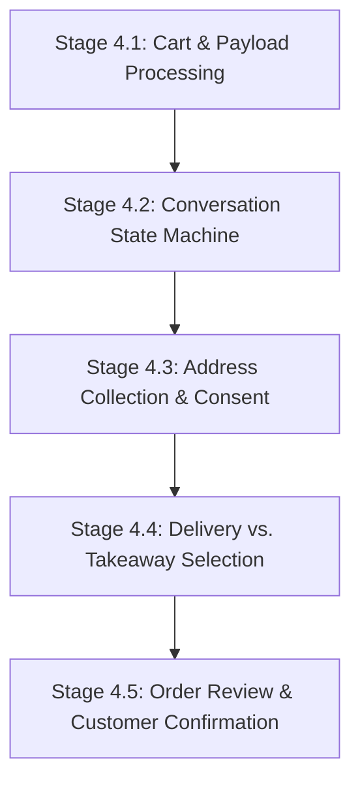
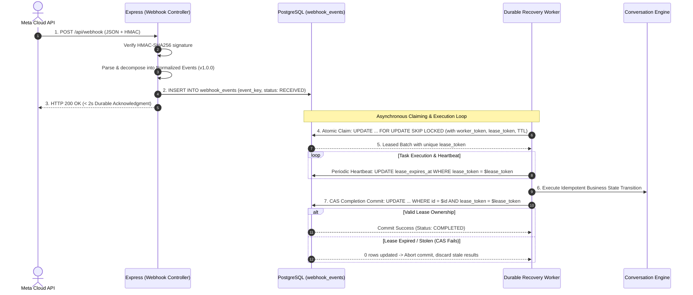
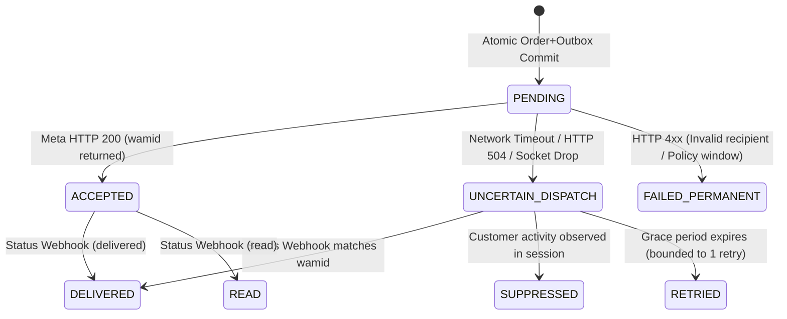

# RESTOPRO — Stage 4: Ordering Engine Implementation Plan

**Document Version:** 2.3.0  
**Status:** Approved for Implementation Planning / Pre-Code Gate  
**Target Architecture:** Multi-Tenant Node.js / Express / PostgreSQL 15+ (Prisma v6) / Meta WhatsApp Cloud API  

---

## 1. Executive Summary & Product Objective

Stage 4 implements the **Single Restaurant Customer Ordering Engine** for RESTOPRO. Building upon the verified cryptographic webhook foundation (Stage 1/1.5) and the hardened PostgreSQL multi-tenant database layer (Stage 2/3), Stage 4 enables a customer to conduct a complete, automated ordering conversation over WhatsApp with a restaurant:
1. Sending an initial greeting ("Hi") and receiving a welcome message with a native catalog prompt.
2. Submitting a shopping cart from the restaurant's native WhatsApp catalog (`type: "order"`).
3. Validating cart line items, quantities, currency, and calculating subtotals with strict rejection of malformed or invalid items.
4. Collecting a delivery address (text or WhatsApp GPS location pin) or offering previously saved addresses with strict tenant isolation.
5. Capturing explicit consent before saving an address.
6. Selecting fulfillment type (**Delivery** vs. **Takeaway**).
7. Reviewing an itemized order summary with interactive **[Confirm Order]** and **[Cancel Order]** buttons embedded with a stable confirmation token.
8. Persisting the confirmed order in PostgreSQL with status `PENDING_RESTAURANT_CONFIRMATION` inside an atomic, database-backed idempotent transaction with row-level session locking.

> [!IMPORTANT]
> **Strict Phase Boundary:** Customer confirmation is **not** restaurant acceptance. Restaurant owner notifications, Accept/Reject interactive buttons, and owner decision processing belong exclusively to **Stage 5**. Stage 4 concludes when the customer's confirmed order is durably persisted with status `PENDING_RESTAURANT_CONFIRMATION`.

---

## 2. Stage 4 Sub-Phases & Implementation Sequence



### 2.1 Stage 4.1 — WhatsApp Cart and Order Payload Processing

#### Objective
Ingest, parse, and defensively validate incoming Meta `type: "order"` payloads without silent data corruption.

#### Field Parsing & Strict Validation Rules
* **Line Items:** Extract `catalog_id`, `product_items`, `product_retailer_id` (SKU), `quantity`, `item_price`, `currency`, and customer notes (`text`).
* **Strict Quantity Validation:**
  * **Rule:** Quantities must be positive integers ($\ge 1$ and $\le 99$).
  * **Negative / Zero / Non-Integer Rule:** **NEVER silently convert invalid quantities to 1.** If a quantity is $< 1$, non-numeric, or floating-point, the cart is rejected as malformed.
* **Strict Price Validation:**
  * **Rule:** Unit prices must be non-negative finite numbers.
  * **Negative / NaN Rule:** **NEVER silently convert invalid prices to 0.** If a price is negative or `NaN`, the cart is rejected.
* **Currency Validation:** All line items must share the identical ISO currency code matching the restaurant's configured currency. If currency mismatch is detected, the cart is rejected.
* **Submitted vs. Authoritative Price Boundary:**
  * Meta's native catalog cart reflects the prices cached on the customer's WhatsApp client at the moment of cart submission.
  * RESTOPRO captures and stores the exact submitted price in the order snapshot (`Order.items` JSONB) for transparent auditability.
  * RESTOPRO does not maintain an internal menu inventory; the restaurant owner serves as the authoritative pricing authority during Stage 5 owner approval.
* **Customer Recovery Behavior:**
  * When a cart is rejected due to invalid quantities, prices, or currency conflicts, RESTOPRO dispatches a clear conversational error message:
    > *"We encountered an issue with your cart selection (e.g. invalid item quantity or price). Please re-open our catalogue and re-add your items."*
  * Accompanied by an interactive `[View Catalogue]` button to resume the flow cleanly.

---

### 2.2 Stage 4.2 — Deterministic Conversation State Machine

#### Objective
Implement a deterministic, database-persisted conversational state engine in `src/services/conversation.service.js`.

#### State Engine Invariants
* **Session Key:** Exactly one active session per `(restaurant_id, customer_phone)` enforced by PostgreSQL unique constraint.
* **Session States:** `IDLE`, `AWAITING_CART`, `AWAITING_ADDRESS_CHOICE`, `AWAITING_ADDRESS_INPUT`, `AWAITING_SAVE_CONSENT`, `AWAITING_ORDER_TYPE`, `AWAITING_CONFIRMATION`.
* **State Persistence:** Transient checkout data (validated cart, subtotal, address, fulfillment type, stable confirmation token) is persisted in `conversation_sessions.state` JSONB.
* **Inactivity TTL:** Sessions expire after 2 hours of customer inactivity (`expires_at = NOW() + INTERVAL '2 hours'`).
* **Recovery & Resiliency:**
  * If the server restarts, customer state is retrieved cleanly from PostgreSQL `conversation_sessions`.
  * If a customer sends messages out-of-order, the state machine issues a contextual re-prompt without corrupting state or crashing.

---

### 2.3 Stage 4.3 — Address Collection and Saved Addresses

#### Objective
Collect delivery addresses with customer consent and strict tenant isolation.

#### Scope & Invariants
* **Saved Address Lookup:** Query `saved_addresses` scoped strictly by `(restaurant_id, customer_phone)`. If found, offer interactive buttons: `[Use Saved Address: <Address>]` or `[Enter New Address]`.
* **Tenant Isolation Invariant:** Addresses saved at Restaurant A are never queried, displayed, or offered when ordering at Restaurant B.
* **Text Address Validation:** Validates minimum length ($\ge 10$ characters). Short addresses return a polite prompt requesting building/street details.
* **WhatsApp Location Pin (`type: "location"`):** Extracts `latitude`, `longitude`, and `address`. Valid `0.0` equator/meridian coordinates are preserved via `safeParseCoordinate()`.
* **Explicit Consent Flow:** New addresses prompt: *"Would you like to save this address for future orders? [Yes, Save] [No]"*. Only saved to `saved_addresses` upon explicit `Yes`.

---

### 2.4 Stage 4.4 — Delivery and Takeaway Selection

#### Objective
Capture and enforce fulfillment mode (`DELIVERY` vs. `TAKEAWAY`).

#### Scope & Invariants
* **Interactive Prompt:** `[🚚 Delivery]` and `[🥡 Takeaway / Pickup]`.
* **Delivery Guard:** `DELIVERY` requires a validated delivery address in session state. If missing, prompts customer for address input.
* **Takeaway Guard:** `TAKEAWAY` bypasses address validation and sets delivery fee to ₹0.00.
* **Pickup Notice:** Displays restaurant pickup notice in the summary.

---

### 2.5 Stage 4.5 — Order Review & Stable Database-Backed Idempotent Confirmation

#### Objective
Render itemized order summary, execute atomic confirmation, and guarantee that concurrent or repeated confirmation requests return the identical existing order without duplicate records.

#### Stable Confirmation Action Token
* **Timing & Generation:** When the conversation transitions to `AWAITING_CONFIRMATION`, the state machine generates a stable confirmation action ID:
  ```javascript
  const confirmationToken = `conf_${crypto.randomUUID()}`;
  ```
* **Session Persistence:** Persisted in PostgreSQL inside `conversation_sessions.state.confirmationToken`. Never derived from volatile timestamps like `session.updated_at`.
* **Interactive Payload Binding:** Embedded directly into the interactive button payload dispatched to WhatsApp:
  ```json
  { "id": "BTN_CONFIRM_ORDER:" + confirmationToken, "title": "✅ Confirm Order" }
  ```

#### Database-Enforced Unique Constraint on Confirmation Tokens
> [!NOTE]
> **Proposed Prerequisite Schema Enhancement (Requires Explicit User Approval):**
> Model `Order` should be augmented with a dedicated unique column:
> ```prisma
> confirmation_token String? @unique @db.VarChar(128)
> ```
> This guarantees that even under race conditions, PostgreSQL will physically reject any concurrent insert with the same confirmation token.

#### Row-Level Session Locking & Idempotent Confirmation Flow
1. **Pessimistic Session Row Locking:**
   When customer taps Confirm, the incoming button ID provides the exact `confirmationToken`. The transaction executes:
   ```sql
   SELECT id, restaurant_id, current_step, state 
   FROM conversation_sessions 
   WHERE restaurant_id = $1 AND customer_phone = $2 
   FOR UPDATE;
   ```
   This locks the session row, serializing any concurrent requests from the same customer.
2. **Idempotency Guard & Safe Return:**
   * Checks whether an order already exists matching `confirmation_token = $confirmationToken`.
   * **If found (Duplicate / Network Retry):** Transaction returns the existing order summary immediately. **Zero duplicate rows are created in `orders`.**
   * **If not found:** Verifies that `session.current_step === 'AWAITING_CONFIRMATION'` and `session.state.confirmationToken === confirmationToken`.
3. **Atomic Order Insertion & Session Teardown:**
   * Generates a collision-free `order_reference`.
   * Inserts into `orders` with `status: PENDING_RESTAURANT_CONFIRMATION`, `confirmation_token: confirmationToken`, item snapshots, and delivery address.
   * Resets `conversation_sessions` to `IDLE` and clears checkout state.
   * Commits the transaction.

#### Targeted Order Reference Collision Handling
* **Format:** `RP-YYMMDD-XXXX` (Date prefix + 4-character cryptographically secure alphanumeric uppercase, e.g. `RP-261105-B8T2`).
* **Database Unique Constraint:** `orders(order_reference)` enforces uniqueness in PostgreSQL.
* **Targeted Constraint Check:**
  * When executing `prisma.order.create()`, catches Prisma error `P2002`.
  * **Crucial Invariant:** Retries **only** if the target field is strictly `order_reference` (`err.meta?.target?.includes('order_reference')`). Unrelated `P2002` errors (e.g. primary key or foreign key conflicts) are immediately re-thrown.
  * **Bounded Retry Strategy:**
    * Attempts 1 to 3: Generate fresh 4-character alphanumeric suffix.
    * Attempt 4 (Fallback): If 3 collisions occur consecutively, append a 6-character hex suffix (`RP-YYMMDD-XXXXXX`) providing $> 16.7$ million entropy.
    * If attempt 4 fails, abort and throw an explicit collision error.

---

## 3. Webhook Recovery Leases & Resilient Background Claiming

RESTOPRO decouples incoming webhook acknowledgment from downstream business processing to prevent event loss, timeouts, and duplicate orders.



### 3.1 Explicit Lease Fields & Prerequisite Schema Migration
> [!NOTE]
> **Proposed Prerequisite Schema Enhancement (Requires Explicit User Approval):**
> To replace ambiguous timestamp checks with explicit distributed lock semantics, model `WebhookEvent` requires four dedicated lease tracking fields:
> ```prisma
> claimed_by       String?   @db.VarChar(64)      // Worker instance identifier (e.g. worker-pm2-1)
> lease_token      String?   @db.Uuid             // Unique cryptographic fencing token generated per claim
> lease_expires_at DateTime? @db.Timestamptz      // Absolute timestamp when lease expires
> attempt_count    Int       @default(0)          // Bounded retry tracking
> ```

### 3.2 Atomic Event Claiming
Workers acquire uncompleted events using a single atomic PostgreSQL statement with `FOR UPDATE SKIP LOCKED`. This guarantees mutual exclusion across concurrent PM2 processes without race conditions:
```sql
UPDATE webhook_events
SET processing_status = 'PROCESSING',
    claimed_by = $worker_id,
    lease_token = gen_random_uuid(),
    lease_expires_at = NOW() + INTERVAL '2 minutes',
    attempt_count = attempt_count + 1
WHERE id IN (
    SELECT id FROM webhook_events
    WHERE (processing_status = 'RECEIVED' AND received_at < NOW() - INTERVAL '15 seconds')
       OR (processing_status = 'PROCESSING' AND lease_expires_at < NOW())
    ORDER BY received_at ASC
    LIMIT 25
    FOR UPDATE SKIP LOCKED
)
RETURNING id, event_key, payload_summary, lease_token;
```

### 3.3 Lease Expiration and Heartbeat Renewal
* **Lease Duration:** Default lease TTL is **120 seconds** (`INTERVAL '2 minutes'`).
* **Heartbeat Keepalive:** For long-running operations, the worker issues a heartbeat renewal every 30 seconds:
  ```sql
  UPDATE webhook_events
  SET lease_expires_at = NOW() + INTERVAL '2 minutes'
  WHERE id = $id AND lease_token = $lease_token AND processing_status = 'PROCESSING';
  ```
* **Preventing Concurrent Reclamation of Live Workers:** As long as a worker is alive and heartbeating, `lease_expires_at` remains in the future. The query condition `lease_expires_at < NOW()` is never met, strictly preventing any secondary worker from stealing or reclaiming the event while the primary worker is actively processing.

### 3.4 Ownership-Token Validation Before Committing (Fencing Token / CAS)
* When a worker completes business logic, it commits completion using Compare-And-Swap (CAS) guarded by its unique `lease_token`:
  ```sql
  UPDATE webhook_events
  SET processing_status = 'COMPLETED',
      processed_at = NOW(),
      claimed_by = NULL,
      lease_token = NULL,
      lease_expires_at = NULL
  WHERE id = $id AND lease_token = $lease_token;
  ```
* **Stale Worker Defense:** If the worker experienced a deep garbage collection pause or network partition exceeding 2 minutes without a heartbeat, another worker may have reclaimed the event. In this event, the CAS statement matches zero rows (`rowCount === 0`). The worker detects that its lease was revoked and **aborts its commit**, preventing stale results from corrupting newer state.

### 3.5 End-to-End Idempotency Guarantee
* If a worker crashes midway and the event is reclaimed by another worker:
  * Conversation session operations are guarded by `SELECT FOR UPDATE`.
  * Order creation checks whether `Order.confirmation_token` exists. If so, it returns the existing order receipt without re-executing checkout or creating duplicate database rows.
  * Outbound messages are guarded by unique deduplication keys.

---

## 4. WhatsApp Outbound Delivery Semantics & Uncertain Outcomes

### 4.1 Reality Check: Meta WhatsApp Cloud API Idempotency Limitations
> [!IMPORTANT]
> **API Limitation Finding:**
> Unlike payment gateways (e.g. Stripe `Idempotency-Key`), **Meta WhatsApp Cloud API's `POST /{phone_number_id}/messages` endpoint DOES NOT support client-generated idempotency headers or payload tokens.**
> Sending an identical HTTP POST request twice to Meta **will cause Meta to deliver two separate WhatsApp messages to the customer's phone.**
> RESTOPRO therefore cannot rely on Meta API headers to deduplicate outbound messages.

### 4.2 Distinguishing Delivery States & Outcomes
RESTOPRO distinguishes between three fundamental dispatch outcomes:



1. **API Acceptance (HTTP 200):**
   * Meta accepted the request and queued it for delivery.
   * Response contains `{ "messages": [{ "id": "wamid.HBgM..." }] }`.
   * RESTOPRO records `meta_message_id = wamid.HBgM...` and transitions outbox status to `ACCEPTED`.
2. **Confirmed Delivery / Read (Asynchronous Webhook):**
   * Meta delivers the message to the customer's handset and asynchronously POSTs a `status: "delivered"` or `status: "read"` receipt to `/api/webhook`.
   * RESTOPRO updates outbox status to `DELIVERED` or `READ`.
3. **Confirmed Permanent Failure (HTTP 4xx):**
   * Client-side errors (e.g., 24-hour customer service window expired, invalid recipient number).
   * Transition to `FAILED_PERMANENT` with `error_message`. Never retried.
4. **Uncertain Outcome (Network Timeout / Socket Drop / HTTP 504):**
   * The HTTP connection was severed after RESTOPRO transmitted request bytes, but before the HTTP response headers were received.
   * Meta **may or may not** have received and dispatched the message.

### 4.3 Handling Uncertain Outcomes (The Reconciliation Strategy)
When an outbound request encounters an uncertain outcome:
1. **Never Blind-Retry Immediately:** Blindly re-sending the message risks sending duplicate receipts to the customer.
2. **Mark Status `UNCERTAIN_DISPATCH`:** Outbox record transitions to `UNCERTAIN_DISPATCH` with `last_attempt_at = NOW()`.
3. **Status Webhook Reconciliation Window (60 Seconds):**
   * If Meta actually received the message, it will emit a webhook status receipt (`sent` / `delivered`) containing recipient phone number and timestamp within 15–30 seconds.
   * When an incoming status webhook arrives matching the recipient and approximate timestamp, RESTOPRO reconciles the message, links the `meta_message_id`, and marks it `DELIVERED`.
4. **Customer Activity Suppression:**
   * If the customer sends another message or taps a button before the retry triggers, they clearly received the message or have moved on. The retry is marked `SUPPRESSED_BY_CUSTOMER_ACTIVITY` to avoid annoying the user.
5. **Bounded Single Fallback Retry:**
   * Only for critical order submission receipts: If after a 60-second reconciliation window no status receipt and no customer activity has occurred, exactly **one** fallback retry is dispatched (`attempt_count = 2`). If that attempt also fails, status transitions to `FAILED` for operational inspection.

---

## 5. Webhook Event Replay Contract & Normalization (v1.0.0)

### 5.1 Versioned Normalized Event Schema
To ensure 100% reconstructibility without retaining raw HTTP request buffers, incoming events are decomposed and persisted in `webhook_events.payload_summary` under **Schema Version 1.0.0**.

#### Master Envelope Structure:
```json
{
  "schema_version": "1.0.0",
  "event_type": "TEXT | ORDER | INTERACTIVE_BUTTON | INTERACTIVE_LIST | LOCATION | STATUS",
  "wamid": "wamid.HBgM...",
  "phone_number_id": "100609346452123",
  "customer_phone": "919876543210",
  "timestamp": 1793886890,
  "data": { ... }
}
```

### 5.2 Required Fields by Supported Event Type

| Event Type | Subtype | Required Data Fields in `data` | Replay Purpose |
| :--- | :--- | :--- | :--- |
| **TEXT** | Greeting / Address | `text` (up to 500 chars) | Greeting triggers welcome; address text triggers validation & consent. |
| **ORDER** | Native Catalog Cart | `catalog_id`, `text` (customer note), `subtotal`, `currency`, `items: [{ product_retailer_id, quantity, item_price, currency }]` | Cart validation, line item subtotaling, session cart storage. |
| **INTERACTIVE_BUTTON** | Quick Reply Tap | `button_id` (e.g. `BTN_CONFIRM_ORDER:<token>`), `button_title` | Decision branching: confirmation, address selection, fulfillment choice. |
| **INTERACTIVE_LIST** | List Row Selection | `list_row_id`, `list_title`, `list_description` | Selection of saved addresses or catalog categories. |
| **LOCATION** | GPS Location Pin | `latitude` (Float), `longitude` (Float), `name` (String?), `address` (String?) | Delivery address capture with coordinate preservation. |
| **STATUS** | Delivery Receipt | `meta_message_id`, `status` (`sent` \| `delivered` \| `read` \| `failed`), `recipient_phone`, `errors: [...]` | Outbox reconciliation, delivery tracking. |

### 5.3 Multi-Message and Multi-Entry Webhook Decomposition
Meta's webhook payload can bundle multiple entries (`entry[]`), changes (`changes[]`), and multiple messages (`messages[]`) or status updates (`statuses[]`) in a single HTTP request:
1. **Decomposition Rule:** The webhook controller **never** saves an entire multi-message batch as a single database row.
2. **Per-Message Normalization:** Every single item inside `messages[]` and `statuses[]` is unpacked into its own dedicated `webhook_events` row.
3. **Deterministic Deduplication Key (`event_key`):**
   * Inbound Message: `wamid.<message_id>`
   * Inbound Status: `status:wamid.<message_id>:<status>`
4. **Chronological Ingestion:** Individual events within a multi-message batch are ordered by their Meta `timestamp` before insertion to prevent state inversions.

### 5.4 PII Retention, Deletion, and Data Minimization
* **Zero Raw Body Retention:** Full unparsed HTTP buffers containing unredacted HTTP headers, access tokens, and temporary signatures are discarded immediately after HMAC verification.
* **Consent-Gated Persistence:** Addresses are stored in `saved_addresses` **only** upon explicit customer consent (`BTN_CONSENT_YES`). If consent is denied (`BTN_CONSENT_NO`), the address is stored only within the single order record for delivery fulfillment.
* **Automated Data Purging Policy:**
  * To comply with DPDP / GDPR data minimization requirements, `webhook_events` older than **30 days** are purged via an automated maintenance routine:
    ```sql
    DELETE FROM webhook_events WHERE received_at < NOW() - INTERVAL '30 days';
    ```
  * `conversation_sessions` older than **7 days** with status `IDLE` are cleaned up.

---

## 6. Prerequisite Schema Migrations (Awaiting Explicit Approval)

Before application code can be written for Stage 4, the following schema additions to `prisma/schema.prisma` must be formally approved:

1. **`orders` table addition:**
   ```prisma
   confirmation_token String? @unique @db.VarChar(128)
   ```
2. **`webhook_events` lease tracking additions:**
   ```prisma
   claimed_by       String?   @db.VarChar(64)
   lease_token      String?   @db.Uuid
   lease_expires_at DateTime? @db.Timestamptz
   attempt_count    Int       @default(0)
   ```
3. **`outbox_messages` table creation:**
   ```prisma
   model OutboxMessage {
     id              String    @id @default(uuid()) @db.Uuid
     restaurant_id   String    @db.Uuid
     recipient_phone String    @db.VarChar(32)
     message_type    String    @db.VarChar(32)
     payload         Json      @db.JsonB
     delivery_status String    @default("PENDING") @db.VarChar(32)
     retry_count     Int       @default(0)
     idempotency_key String    @unique @db.VarChar(128)
     meta_message_id String?   @db.VarChar(128)
     error_message   String?   @db.Text
     created_at      DateTime  @default(now()) @db.Timestamptz
     dispatched_at   DateTime? @db.Timestamptz

     restaurant Restaurant @relation(fields: [restaurant_id], references: [id], onDelete: Cascade)
     @@index([delivery_status, retry_count])
     @@map("outbox_messages")
   }
   ```

---

## 7. Definition of Done for Stage 4

Stage 4 is complete when:
1. All 5 sub-phases (4.1 through 4.5) are fully implemented and verified with automated test suites.
2. Malformed or invalid cart items are strictly rejected with customer recovery prompts.
3. Order confirmations are guaranteed unique and database-idempotent using stable action tokens and session row locking.
4. Order references are guaranteed collision-free via targeted unique constraint retry loops.
5. Durable webhook recovery mechanisms with explicit lease fields, heartbeat renewal, and CAS fencing tokens are implemented.
6. WhatsApp outbound delivery semantics handle uncertain Meta API outcomes via status receipt reconciliation without customer spam.
7. Webhook event replay contract v1.0.0 is enforced with automated test coverage across all 6 supported event types.
8. All 151 existing regression tests pass alongside new Stage 4 tests.
9. Zero owner alert, accept/reject, or notification code is implemented (strict Stage 5 boundary preserved).
