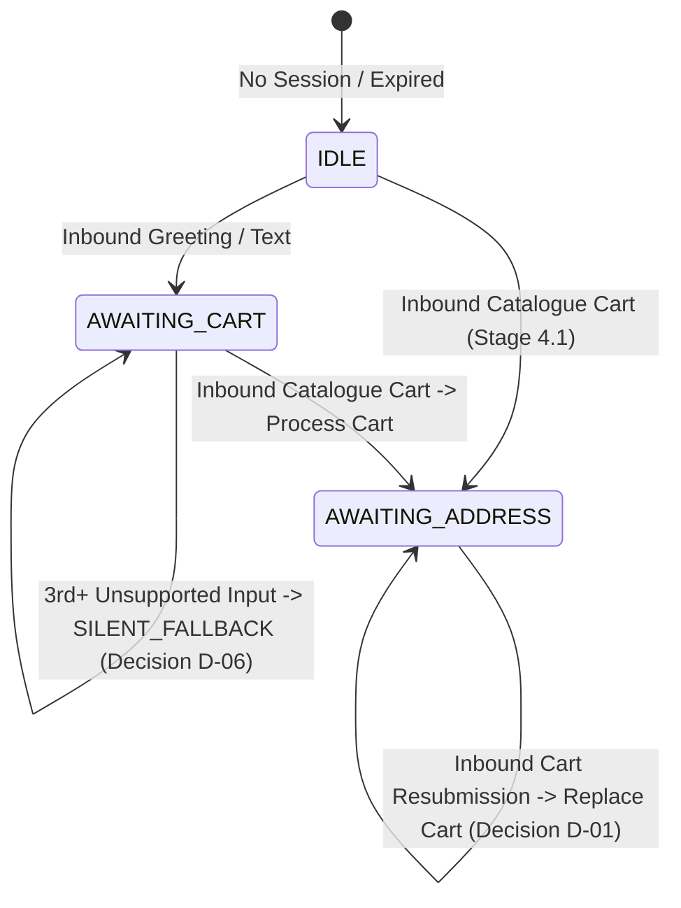

# RESTOPRO — Stage 4.2: Conversation Engine Implementation Results

**Document Version:** 1.0.0  
**Status:** Complete & Fully Verified  
**Execution Date:** 2026-11-05  
**Component:** Deterministic Finite State Machine & Conversation Router  
**Test Suite:** `test/stage4-conversation-test.js` (52/52 Passing Assertions)  
**Total Master Assertions:** 321/321 Passing Across 6 Test Suites  

---

## 1. Executive Summary

Stage 4.2 implements the **Deterministic Conversation State Engine** for RESTOPRO. The engine resolves tenant context strictly via Meta's incoming `phone_number_id`, tracks customer sessions by `(restaurant_id, customer_phone)`, validates incoming inputs against an explicit whitelist for the active conversation step, persists transitions atomically in PostgreSQL, updates the 2-hour inactivity TTL, and caps consecutive unsupported reminders at 2 before going quiet (Decision D-06).

Zero AI, NLP, or fuzzy matching is employed; all conversational routing is governed by strict deterministic rules. Zero Order records and zero actual WhatsApp outbound sends were implemented in this phase.

---

## 2. Implemented States & Transition Matrix

| Current Step | Incoming Event Type | Input Validation | Next Step | Action Dispatched |
| :--- | :--- | :--- | :--- | :--- |
| **`IDLE`** | `text` (Greeting or any text) | Non-empty string | `AWAITING_CART` | `SEND_WELCOME_CATALOG` |
| **`IDLE`** | `order` | Valid catalogue cart | Address Step | `PROMPT_ADDRESS_COLLECTION` |
| **`IDLE`** | `button` / `interactive` | Any | `AWAITING_CART` | `SEND_WELCOME_CATALOG` |
| **`AWAITING_CART`** | `order` | Valid catalogue cart | Address Step | `PROMPT_ADDRESS_COLLECTION` |
| **`AWAITING_CART`** | `text` | Inquiries / questions | `AWAITING_CART` | `REDIRECT_TO_CATALOG` (Decision D-02) |
| **`AWAITING_CART`** | Unsupported / Button | Unrecognized | `AWAITING_CART` | `CONTEXTUAL_REPROMPT` (or `SILENT_FALLBACK` if count > 2) |
| **`AWAITING_ADDRESS_CHOICE`** | `button` | Whitelisted button ID | Step preserved | `VALID_INTERACTIVE_ACTION` |
| **`AWAITING_ADDRESS_CHOICE`** | `button` | Invalid button ID | Step preserved | `CONTEXTUAL_REPROMPT` (No state corruption) |
| **`AWAITING_ADDRESS_INPUT`** | `text` | Length $\ge 10$ chars | Step preserved | `VALID_TEXT_INPUT` |
| **`AWAITING_ADDRESS_INPUT`** | `location` | Valid GPS coordinates | Step preserved | `VALID_LOCATION_INPUT` |
| **`AWAITING_SAVE_CONSENT`** | `button` | `BTN_CONSENT_YES/NO` | Step preserved | `VALID_INTERACTIVE_ACTION` |
| **`AWAITING_ORDER_TYPE`** | `button` | `BTN_ORDER_DELIVERY/TAKEAWAY` | Step preserved | `VALID_INTERACTIVE_ACTION` |
| **`AWAITING_CONFIRMATION`** | `button` | Matching `BTN_CONFIRM_ORDER:<token>` | Step preserved | `VALID_INTERACTIVE_ACTION` |
| **`AWAITING_CONFIRMATION`** | `button` | Stale or mismatched token | Step preserved | Rejected / `CONTEXTUAL_REPROMPT` |

---

## 3. Whitelist Validation Rules for Interactive Actions

Interactive buttons and list rows are strictly validated by `validateActionForStep()`:

| Conversation Step | Whitelisted Interactive Action IDs | Disallowed Actions |
| :--- | :--- | :--- |
| **`AWAITING_CART`** | *None* | All buttons/lists rejected (redirect to catalog) |
| **`AWAITING_ADDRESS_CHOICE`** | `BTN_USE_SAVED_ADDRESS`, `BTN_ENTER_NEW_ADDRESS`, `ADDR_SAVED_*` | All other button IDs |
| **`AWAITING_ADDRESS_INPUT`** | *None* (Expects text or GPS location) | All button IDs |
| **`AWAITING_SAVE_CONSENT`** | `BTN_CONSENT_YES`, `BTN_CONSENT_NO` | All other button IDs |
| **`AWAITING_ORDER_TYPE`** | `BTN_ORDER_DELIVERY`, `BTN_ORDER_TAKEAWAY` | All other button IDs |
| **`AWAITING_CONFIRMATION`** | `BTN_CONFIRM_ORDER:<token>` (token must match `state.confirmationToken`), `BTN_CANCEL_ORDER`, `BTN_CHANGE_ADDRESS` | Mismatched tokens, stale tokens, premature buttons |

---

## 4. Unsupported Input & Retry Limit Behavior (Decision D-06)

To prevent messaging loops when confused users send invalid inputs:
1. **1st Unsupported Input:** State records `unsupportedCount = 1`; dispatches `CONTEXTUAL_REPROMPT` with step-specific guidance.
2. **2nd Unsupported Input:** State records `unsupportedCount = 2`; dispatches `CONTEXTUAL_REPROMPT`.
3. **3rd+ Unsupported Input:** Action transitions to `SILENT_FALLBACK`. The engine goes quiet without spamming the customer.
4. **Valid Input Reset:** Upon receiving any valid input matching the step whitelist, `unsupportedCount` immediately resets to `0`.

---

## 5. Inactivity Expiration & Session Integrity

* **2-Hour Inactivity TTL:** Every message transition updates `expires_at = NOW() + 2 hours` (`INACTIVITY_TTL_MS = 7,200,000`).
* **Expired Session Handling:** If a session's `expires_at` is in the past, previous stale state is discarded. A new greeting cleanly resets the session to `AWAITING_CART`.
* **Zero State Corruption Under Invalid Inputs:** When an invalid button ID or malformed message arrives, `session.current_step`, `session.state.cart`, and `session.state.confirmationToken` are preserved intact.

---

## 6. Master Test Results (321 / 321 Passed)

### Stage 4.2 Test Suite Breakdown (`test/stage4-conversation-test.js` — 52 Assertions):
* **Group 1: Valid Text Input (11 assertions):** Initial greeting in `IDLE`, inquiry in `AWAITING_CART`, valid address text in `AWAITING_ADDRESS_INPUT`.
* **Group 2: Whitelist Validation (7 assertions):** Button/list verification for address choice, save consent, order type, and confirmation tokens.
* **Group 3: Invalid Action Rejection Defense (4 assertions):** Stale token rejection, premature button rejection, list reply rejection.
* **Group 4: Unsupported Input & 2-Reminder Limit (9 assertions):** 1st reprompt, 2nd reprompt, 3rd silent fallback.
* **Group 5: Session Integrity (3 assertions):** Verifying cart subtotal and confirmation token are uncorrupted after invalid inputs.
* **Group 6: Expired Session Recovery (3 assertions):** Expired session reset on fresh greeting.
* **Group 7: Tenant & Customer Isolation (3 assertions):** Independent sessions for same customer at different tenants.
* **Group 8: Webhook Pipeline Integration (12 assertions):** Greeting through HTTP POST `/api/webhook`, duplicate greeting deduplication, multi-message payload decomposition, concurrent transitions via `Promise.all`.

### Complete Repository Verification Summary:
| Test Suite Command | Target Scope | Passed | Failed |
| :--- | :--- | :--- | :--- |
| `npm run test:webhook` | Stage 1 & 1.5 Security & Webhooks | 86 | 0 |
| `npm run test:stage2` | Stage 2 & 3 Multi-Tenant DB | 59 | 0 |
| `npm run test:stage4:migration` | Stage 4.0 Schema Prerequisites | 30 | 0 |
| `npm run test:stage4:cart` | Stage 4.1 Cart Processing & Sessions | 88 | 0 |
| `npm run test:stage4:conversation` | Stage 4.2 Conversation Engine & FSM | 52 | 0 |
| `npm run test:shutdown` | Stage 3 Signal & Shutdown Lifecycle | 6 | 0 |
| **Total Test Assertions** | **Complete RESTOPRO Backend** | **321** | **0** |

---

## 7. Known Limitations & Phase Boundaries

1. **No Outbound Messaging Dispatch:** Structured response actions are emitted; actual WhatsApp delivery via the outbox occurs in later stages.
2. **Address Persistence Stubs:** Address text validation and GPS pin handling are staged for full persistence in Stage 4.3.
3. **Fulfillment & Confirmation Stubs:** Delivery/Takeaway selection and Order record insertion are staged for Stages 4.4 and 4.5.

