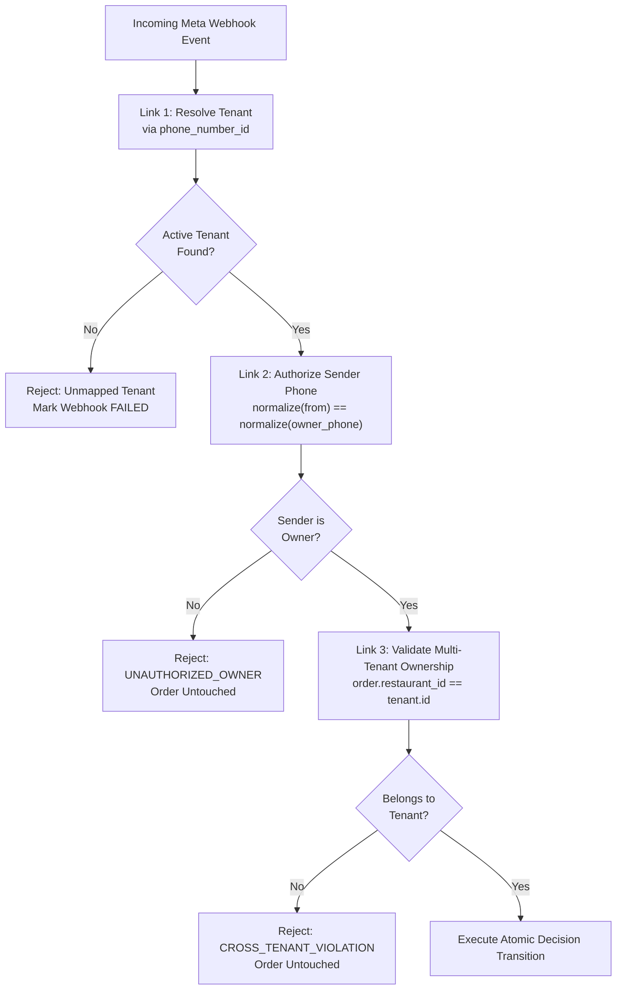

# RESTOPRO — Stage 5.2: Owner Accept / Reject Processing Results

**Document Version:** 1.0.0  
**Stage:** 5.2 — Owner Accept / Reject Decision Processing  
**Date:** 2026-11-05  
**Author:** RESTOPRO Engineering Team  
**Status:** APPROVED & FULLY VERIFIED  

---

## 1. Executive Summary

Stage 5.2 implements the owner decision processing engine for RESTOPRO. Restaurant owners receive interactive WhatsApp order alerts and can tap **✅ Accept** or **❌ Reject**. This stage handles incoming Meta interactive button callbacks (`OWNER_ACCEPT:<order_id>` and `OWNER_REJECT:<order_id>`), enforces strict owner phone authorization, validates cross-tenant scoping, and executes atomic order status transitions using PostgreSQL row-level locks (`SELECT ... FOR UPDATE`). Conflicting second decisions are rejected, duplicate identical taps are handled idempotently, and customer or stranger attempts are blocked.

All **78 out of 78 test assertions passed** in the dedicated Stage 5.2 test suite, and the full regression test harness completed with **633 out of 633 passed assertions (100% success rate)** across all test suites.

---

## 2. Architecture & Design Implementation

### 2.1 Owner Authorization & Verification Chain (`ST5-04`, `ST5-05`)
To guarantee that neither customers nor unauthorized third parties can alter restaurant orders, a three-link verification chain is strictly enforced:



1. **Link 1 (Tenant Resolution):** Resolved exclusively by Meta's incoming recipient `phone_number_id` (`resolveTenantByPhoneNumberId`). The tenant is never inferred from customer phone or order ID.
2. **Link 2 (Sender Phone Authorization):** Sender phone number (`event.senderPhone`) is normalized to bare digits and compared against `restaurant.owner_phone`. If a customer or stranger attempts to send an `OWNER_ACCEPT` or `OWNER_REJECT` payload, the action is rejected with `UNAUTHORIZED_OWNER` and logged as a security event.
3. **Link 3 (Tenant Order Ownership):** Verifies `order.restaurant_id === restaurant.id`. Even if an owner of Restaurant B sends a request, Restaurant A's orders cannot be accessed or modified (`CROSS_TENANT_VIOLATION`).

### 2.2 Payload Parsing & Validation (`ST5-03`)
In [`src/services/order.service.js`](file:///m:/For%20Other/Saeem/Only%20Whatsapp/src/services/order.service.js), `parseOwnerAction` validates incoming button payloads:
- Format: `^OWNER_(ACCEPT|REJECT):(.*)$`
- Enforces UUID regular expression: `/^[0-9a-f]{8}-[0-9a-f]{4}-[1-5][0-9a-f]{3}-[89ab][0-9a-f]{3}-[0-9a-f]{12}$/i`
- Rejects malformed payloads (missing UUID, non-UUID identifiers, invalid action names like `OWNER_MAYBE`, null/empty payloads) with specific rejection codes (`INVALID_ORDER_ID`, `UNRECOGNIZED_OWNER_ACTION`).

### 2.3 Atomic Order State Transitions (`ST5-06`)
Decisions are executed within a PostgreSQL transaction with pessimistic row-level locking:

```javascript
// src/services/order.service.js
const runner = async (tx) => {
  // Lock the order row to serialize concurrent decisions
  const rows = await tx.$queryRaw`
    SELECT id, restaurant_id, order_reference, customer_phone, customer_name, status, total_amount, currency, decision_at
    FROM orders
    WHERE id = ${effectiveOrderId}::uuid
    FOR UPDATE;
  `;

  if (!rows || rows.length === 0) {
    return { success: false, code: 'ORDER_NOT_FOUND', error: 'Order not found.' };
  }

  const order = rows[0];
  if (order.restaurant_id !== restaurantId) {
    return { success: false, code: 'CROSS_TENANT_VIOLATION', error: 'Order belongs to another restaurant.' };
  }

  const targetStatus = effectiveDecision === 'ACCEPT' ? 'ACCEPTED' : 'REJECTED';

  // State 1: Order is PENDING_RESTAURANT_CONFIRMATION -> Transition atomically
  if (order.status === 'PENDING_RESTAURANT_CONFIRMATION') {
    const decisionAt = new Date();
    const updatedOrder = await tx.order.update({
      where: { id: order.id },
      data: {
        status: targetStatus,
        decision_at: decisionAt
      }
    });

    return {
      success: true,
      order: updatedOrder,
      decision: effectiveDecision,
      previousStatus: 'PENDING_RESTAURANT_CONFIRMATION',
      newStatus: targetStatus,
      decisionAt,
      isDuplicate: false
    };
  }
  ...
};
```

### 2.4 Duplicate & Concurrency Handling (`ST5-07`)

1. **Repeated Identical Decisions (Idempotent Replay):**
   - If an owner taps **✅ Accept** twice or network retries resend the webhook, the second request detects `order.status === targetStatus`.
   - Returns `{ success: true, isDuplicate: true, alreadyDecided: true }` without mutating database fields, preserving the original `decision_at` timestamp and creating zero duplicate notifications.

2. **Conflicting Decision Guard:**
   - Once an order reaches `ACCEPTED` or `REJECTED`, it enters a terminal state.
   - If an owner taps **❌ Reject** on an already `ACCEPTED` order, the system rejects the modification with `CONFLICTING_DECISION` and preserves `status: 'ACCEPTED'`.
   - If an order is `EXPIRED` or `CANCELLED`, decision attempts are rejected with `CONFLICTING_DECISION`.

3. **Concurrent Race Condition Defense:**
   - When conflicting requests (e.g. simultaneous Accept and Reject) arrive in the exact same millisecond, PostgreSQL `FOR UPDATE` serializes execution.
   - The first request acquires the lock, transitions the order from `PENDING_RESTAURANT_CONFIRMATION` to its decision, and commits.
   - The second request acquires the lock, observes that the order is no longer in `PENDING_RESTAURANT_CONFIRMATION`, and fails cleanly with `CONFLICTING_DECISION`.

### 2.5 Webhook Pipeline Integration
In [`src/controllers/webhook.controller.js`](file:///m:/For%20Other/Saeem/Only%20Whatsapp/src/controllers/webhook.controller.js), incoming message events are inspected for owner action prefixes:
- Actions starting with `OWNER_` bypass customer conversation state machine routing and are dispatched to `processOwnerOrderDecision`.
- Webhook persistence, HMAC-SHA256 signature verification, and `event_key` deduplication operate identically to customer webhooks.
- Returns HTTP 200 `EVENT_RECEIVED` after durable database recording.

---

## 3. Database Schema Status

**Zero Schema Migrations Required:**
The existing PostgreSQL schema and Prisma models already contain all required attributes:
- `Order.status`: `OrderStatus` enum includes `PENDING_RESTAURANT_CONFIRMATION`, `ACCEPTED`, `REJECTED`, `EXPIRED`, `CANCELLED`.
- `Order.decision_at`: `DateTime? @db.Timestamptz()` persists exact decision timestamps.
- Composite uniqueness on `orders (id, restaurant_id)` enforces referential isolation.

---

## 4. Test Verification & Results

### 4.1 Stage 5.2 Test Breakdown (`test/stage5-owner-decision-test.js`)

| Group | Focus | Assertions | Result |
| :--- | :--- | :---: | :---: |
| **Group 1** | Valid Owner Decision Transitions (`ACCEPT` & `REJECT`) | 14 / 14 | ✅ PASSED |
| **Group 2** | Owner Authorization & Identity Defense (Stranger, Customer, Owner B) | 10 / 10 | ✅ PASSED |
| **Group 3** | Cross-Tenant Order Isolation & Unknown Orders | 5 / 5 | ✅ PASSED |
| **Group 4** | Malformed Payload Validation (Missing UUID, Non-UUID, Bad Prefix) | 7 / 7 | ✅ PASSED |
| **Group 5** | Idempotency & Repeat Identical Decisions | 11 / 11 | ✅ PASSED |
| **Group 6** | Conflicting Decisions & Terminal States (`ACCEPTED`, `REJECTED`, `EXPIRED`) | 12 / 12 | ✅ PASSED |
| **Group 7** | Concurrency & Race Condition Defense (`Promise.all`) | 4 / 4 | ✅ PASSED |
| **Group 8** | Webhook Pipeline Integration (HTTP POST with HMAC & Deduplication) | 15 / 15 | ✅ PASSED |
| **Total** | **Stage 5.2 Dedicated Test Suite** | **78 / 78** | **✅ 100% PASSED** |

### 4.2 Full System Regression Summary

| Test Script | Focus Area | Assertions | Result |
| :--- | :--- | :---: | :---: |
| `npm run test:webhook` | Stage 1.5 Webhook HMAC security & parsing | 86 / 86 | ✅ PASSED |
| `npm run test:stage2` | Stage 2 Multi-tenant isolation & constraints | 59 / 59 | ✅ PASSED |
| `npm run test:stage4:migration` | Stage 4.0 Schema migrations & indexes | 30 / 30 | ✅ PASSED |
| `npm run test:stage4:cart` | Stage 4.1 Catalogue cart processing & validation | 88 / 88 | ✅ PASSED |
| `npm run test:stage4:conversation` | Stage 4.2 State machine & reminders | 52 / 52 | ✅ PASSED |
| `npm run test:stage4:address` | Stage 4.3 Address collection, GPS & consent | 116 / 116 | ✅ PASSED |
| `npm run test:stage4:fulfilment` | Stage 4.4 Fulfilment selection & review | 58 / 58 | ✅ PASSED |
| `npm run test:stage5:outbox` | Stage 5.1 Owner notification & outbox dispatch | 60 / 60 | ✅ PASSED |
| `npm run test:stage5:decision` | Stage 5.2 Owner decision processing | 78 / 78 | ✅ PASSED |
| `npm run test:shutdown` | Graceful shutdown & connection cleanup | 6 / 6 | ✅ PASSED |
| **Combined** | **Full System Regression Harness** | **633 / 633** | **✅ 100% PASSED** |

---

## 5. Files Created & Modified

1. **[`src/services/order.service.js`](file:///m:/For%20Other/Saeem/Only%20Whatsapp/src/services/order.service.js)**: Added `normalizePhone`, `parseOwnerAction`, and `processOwnerOrderDecision` with atomic row-level locking.
2. **[`src/controllers/webhook.controller.js`](file:///m:/For%20Other/Saeem/Only%20Whatsapp/src/controllers/webhook.controller.js)**: Integrated owner action routing before conversation engine dispatch.
3. **[`package.json`](file:///m:/For%20Other/Saeem/Only%20Whatsapp/package.json)**: Added `"test:stage5:decision"` script.
4. **[`test/stage5-owner-decision-test.js`](file:///m:/For%20Other/Saeem/Only%20Whatsapp/test/stage5-owner-decision-test.js)**: 78-assertion test suite.
5. **[`docs/07-IMPLEMENTATION-CHECKLIST.md`](file:///m:/For%20Other/Saeem/Only%20Whatsapp/docs/07-IMPLEMENTATION-CHECKLIST.md)**: Marked items `ST5-03`, `ST5-04`, `ST5-05`, `ST5-06`, and `ST5-07` as completed (`[x]`).

---

## 6. Scope Boundaries Maintained

- **No Stage 5.3 code:** Customer final decision notifications (acceptance and rejection alerts to customers) are strictly reserved for Stage 5.3.
- **No Git commits or pushes:** Working tree is preserved for review.
- **No unapproved schema migrations:** Existing `OrderStatus` enum and `decision_at` column used.

