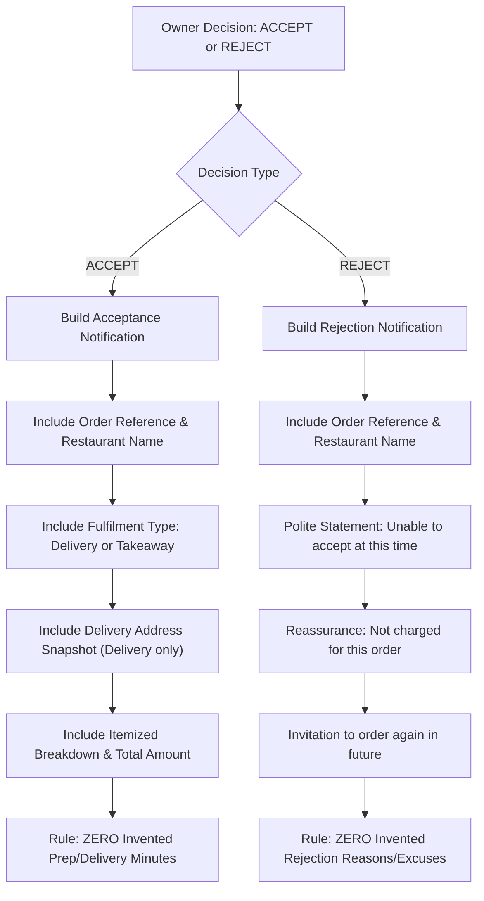

# RESTOPRO — Stage 5.3: Customer Order Decision Notifications Results

**Document Version:** 1.0.0  
**Stage:** 5.3 — Customer Order Decision Notifications  
**Date:** 2026-11-05  
**Author:** RESTOPRO Engineering Team  
**Status:** APPROVED & FULLY VERIFIED  

---

## 1. Executive Summary

Stage 5.3 implements the customer notification delivery engine triggered by owner order decisions in RESTOPRO. When a restaurant owner accepts or rejects an order via interactive WhatsApp buttons, the system immediately schedules and dispatches a customer-facing notification through the durable WhatsApp Cloud API outbox.

Key architectural and functional capabilities delivered in Stage 5.3:
1. **Polite, Transparent Notification Formatting:**
   - **Acceptance:** Confirms order acceptance, displays the restaurant name, order reference (`RP-YYMMDD-XXXX`), fulfilment type (Delivery vs Takeaway), delivery address snapshot (omitted for Takeaway), item summary, and total amount. Strictly **zero invented preparation or delivery time** is ever stated or implied.
   - **Rejection:** Politely communicates that the restaurant cannot accept the order, displays the order reference and restaurant name, reassures the customer that no charge was made, and invites them to order again. Strictly **zero invented rejection reasons or kitchen excuses** are generated.
2. **Transactional Outbox Atomicity:** The order status transition (`ACCEPTED` or `REJECTED`) and the customer notification outbox record (`OutboxMessage` with `message_type: 'CUSTOMER_ORDER_DECISION'`) along with the audit log (`OrderNotification`) are executed within the **exact same PostgreSQL database transaction** under a `SELECT ... FOR UPDATE` row lock. If outbox insertion fails, the order status transition rolls back completely, ensuring **zero leaked or desynchronized decisions**.
3. **Idempotency & Duplicate Decision Defense:** Every customer notification uses a deterministic idempotency key (`customer_decision_${order.id}_${decision.toLowerCase()}`). Repeated identical owner taps (or replayed webhooks) return `{ isDuplicate: true }` and create **zero duplicate notifications**. Conflicting decisions (e.g. attempting to Reject an already Accepted order) are rejected with `CONFLICTING_DECISION` and create **zero customer notifications**.
4. **Multi-Tenant Recipient & Credential Isolation:** Notifications are dispatched strictly via the respective tenant's configured WhatsApp Cloud API credentials (`phone_number_id` and access token) and sent exclusively to the ordering customer's normalized WhatsApp number.
5. **Durable Outbox Dispatch & Failure Semantics:** The outbox worker dispatches messages outside the DB transaction. It handles Meta API success (`ACCEPTED`), client/auth errors (`FAILED` with access tokens strictly redacted from error messages), network timeouts (`UNCERTAIN_DISPATCH` to prevent duplicate messaging), and 5xx transient errors with bounded retries.

All **89 out of 89 test assertions passed** in the dedicated Stage 5.3 test suite, and the full regression test harness completed with **722 out of 722 passed assertions (100% success rate)** across all 11 test suites.

---

## 2. Architecture & Design Implementation

### 2.1 Customer Notification Message Construction (`ST5-08`)
In [`src/services/whatsapp.service.js`](file:///m:/For%20Other/Saeem/Only%20Whatsapp/src/services/whatsapp.service.js), `buildCustomerDecisionNotificationPayload` formats customer notifications:



#### Sample Acceptance Notification (Delivery):
```text
🎉 *Order Accepted!*

Great news! *Spice Garden Restaurant* has accepted your order (*RP-261105-GJ45*).
The restaurant is preparing your food now.

*Order Summary:*
• 2x Butter Chicken (₹480.00)
• 1x Garlic Naan (₹60.00)
*Total:* ₹540.00

*Fulfilment:* 🛵 Delivery
*Delivery Address:* 123 MG Road, Apt 4B, Koramangala

We will notify you when there are further updates on your order.
```

#### Sample Acceptance Notification (Takeaway):
```text
🎉 *Order Accepted!*

Great news! *Spice Garden Restaurant* has accepted your order (*RP-261105-I80X*).
The restaurant is preparing your food now.

*Order Summary:*
• 1x Margherita Pizza (₹250.00)
*Total:* ₹250.00

*Fulfilment:* 🛍️ Takeaway (Self-Pickup)

Please visit the restaurant to collect your order once ready.
```

#### Sample Rejection Notification:
```text
Order Update for *RP-261105-32QC*

We're sorry, but *Spice Garden Restaurant* is unable to accept your order at this time.
You have not been charged for this order.

We apologize for the inconvenience and hope to serve you again soon!
```

### 2.2 Atomic Transaction & Outbox Enqueueing
In [`src/services/order.service.js`](file:///m:/For%20Other/Saeem/Only%20Whatsapp/src/services/order.service.js), `processOwnerOrderDecision` performs the entire state transition and outbox record insertion inside a single database transaction:

```javascript
// src/services/order.service.js
const runner = async (tx) => {
  // 1. Pessimistic row locking
  const rows = await tx.$queryRaw`
    SELECT id, restaurant_id, order_reference, customer_phone, customer_name,
           status, total_amount, currency, order_type, address_snapshot, items, decision_at
    FROM orders
    WHERE id = ${effectiveOrderId}::uuid
    FOR UPDATE;
  `;
  ...
  // 2. Build WhatsApp Cloud API notification payload
  const notificationPayload = buildCustomerDecisionNotificationPayload({
    order: {
      id: order.id,
      order_reference: order.order_reference,
      customer_phone: order.customer_phone,
      customer_name: order.customer_name,
      order_type: order.order_type,
      address_snapshot: order.address_snapshot,
      items: order.items,
      total_amount: order.total_amount,
      currency: order.currency
    },
    decision: effectiveDecision,
    restaurantName: restaurant.name
  });

  const idempotencyKey = `customer_decision_${order.id}_${effectiveDecision.toLowerCase()}`;

  // 3. Atomically update Order status
  const updatedOrder = await tx.order.update({
    where: { id: order.id },
    data: { status: targetStatus, decision_at: decisionAt }
  });

  // 4. Atomically persist OutboxMessage
  const outboxMessage = await tx.outboxMessage.create({
    data: {
      restaurant_id: restaurant.id,
      recipient_phone: cleanCustomerPhone,
      message_type: 'CUSTOMER_ORDER_DECISION',
      payload: notificationPayload,
      idempotency_key: idempotencyKey,
      status: 'PENDING',
      attempts: 0,
      next_retry_at: new Date()
    }
  });

  // 5. Atomically persist OrderNotification audit row
  const orderNotification = await tx.orderNotification.create({
    data: {
      order_id: order.id,
      notification_type: notificationType,
      recipient: cleanCustomerPhone,
      delivery_status: 'PENDING'
    }
  });

  return {
    success: true,
    order: updatedOrder,
    outboxMessage,
    orderNotification,
    ...
  };
};
```

### 2.3 Rollback & Leaked Decision Defense
If `tx.outboxMessage.create` fails (e.g. foreign key violation, schema constraint, or database deadlock), the entire transaction aborts.
- PostgreSQL rolls back the `orders` row to its previous state (`PENDING_RESTAURANT_CONFIRMATION`).
- `decision_at` remains `null`.
- Zero phantom decisions or unsent notifications exist in the system.

### 2.4 Idempotency & Conflict Guard
- **Deterministic Key:** `customer_decision_${order.id}_${decision.toLowerCase()}`.
- **Duplicate Decision (Replay):** If an owner taps Accept multiple times, the transaction detects `order.status === targetStatus`, returns `{ isDuplicate: true, alreadyDecided: true }`, and exits without inserting additional outbox records.
- **Conflicting Decision:** If an owner attempts to Reject an already Accepted order (or Accept an already Rejected order), the transaction detects the terminal state mismatch and returns `{ success: false, code: 'CONFLICTING_DECISION' }`, preventing conflicting notifications from ever being queued.

### 2.5 Outbox Dispatcher & Meta API Semantics
Outbound message dispatch is handled asynchronously by [`src/services/outbox.service.js`](file:///m:/For%20Other/Saeem/Only%20Whatsapp/src/services/outbox.service.js):
1. **Network Calls Outside DB Transaction:** External HTTP calls to `graph.facebook.com` are executed completely outside PostgreSQL transactions, keeping connection pool hold times minimal.
2. **Success (`ACCEPTED`):** On HTTP 200/201 from Meta, the outbox row transitions to `ACCEPTED`, and `meta_message_id` is recorded in payload JSONB.
3. **Client/Auth Error (`FAILED`):** Non-retryable 4xx errors mark the message `FAILED`. Access tokens and sensitive auth headers are scrubbed and redacted from `last_error`.
4. **Timeout (`UNCERTAIN_DISPATCH`):** If Meta does not respond within the HTTP timeout (default 10s), the outbox row transitions to `UNCERTAIN_DISPATCH`. The worker never blindly retries uncertain messages, preventing duplicate WhatsApp messages to the customer.
5. **Transient 5xx Errors:** 5xx errors keep status `PENDING`, increment `attempts`, and apply bounded exponential backoff up to 3 attempts.

---

## 3. Database Schema Status

**Zero Schema Migrations Required:**
The existing PostgreSQL schema and Prisma models (introduced in Stage 2 and Stage 4.0) were 100% sufficient:
- `OrderNotification.notification_type`: Already contains `CUSTOMER_ORDER_ACCEPTED` and `CUSTOMER_ORDER_REJECTED`.
- `OutboxMessage`: Already supports arbitrary message types (`CUSTOMER_ORDER_DECISION`), JSONB payloads, and unique idempotency keys (`idempotency_key VARCHAR(128) UNIQUE`).
- Composite foreign keys guarantee referential integrity and multi-tenant isolation.

---

## 4. Test Verification & Results

### 4.1 Stage 5.3 Test Breakdown (`test/stage5-customer-notification-test.js`)

| Group | Focus | Assertions | Result |
| :--- | :--- | :---: | :---: |
| **Group 1** | Customer Notification Content & Formatting (Accept vs Reject, Delivery vs Takeaway, Zero Invented Times/Reasons) | 29 / 29 | ✅ PASSED |
| **Group 2** | Atomic Owner Decision & Customer Outbox Persistence (DB Atomicity, Rollback on Outbox Collision) | 16 / 16 | ✅ PASSED |
| **Group 3** | Idempotency & Repeat / Conflicting Decisions (Zero Duplicates on Replay, Zero Leaks on Conflict) | 10 / 10 | ✅ PASSED |
| **Group 4** | Multi-Tenant Recipient & Credential Isolation (Tenant A -> Customer A; Tenant B -> Customer B) | 14 / 14 | ✅ PASSED |
| **Group 5** | Outbox Dispatcher Integration & Delivery Semantics (`ACCEPTED`, `FAILED` with Token Redaction, `UNCERTAIN_DISPATCH` on Timeout, Retry Expiry) | 15 / 15 | ✅ PASSED |
| **Group 6** | Webhook Pipeline Integration (End-to-End HTTP POST with HMAC, DB Persistence & Dispatch) | 5 / 5 | ✅ PASSED |
| **Total** | **Stage 5.3 Dedicated Test Suite** | **89 / 89** | **✅ 100% PASSED** |

### 4.2 Full System Regression Summary

All 11 test suites were executed sequentially against PostgreSQL:

| Test Script | Focus Area | Assertions | Result |
| :--- | :--- | :---: | :---: |
| `npm run test:webhook` | Stage 1.5 Webhook HMAC security & parsing | 86 / 86 | ✅ PASSED |
| `npm run test:stage2` | Stage 2 Multi-tenant isolation & constraints | 59 / 59 | ✅ PASSED |
| `npm run test:stage4:migration` | Stage 4.0 Schema migrations & indexes | 30 / 30 | ✅ PASSED |
| `npm run test:stage4:cart` | Stage 4.1 Catalogue cart processing & validation | 88 / 88 | ✅ PASSED |
| `npm run test:stage4:conversation` | Stage 4.2 State machine & reminders | 52 / 52 | ✅ PASSED |
| `npm run test:stage4:address` | Stage 4.3 Address collection, GPS & consent | 116 / 116 | ✅ PASSED |
| `npm run test:stage4:fulfilment` | Stage 4.4 Fulfilment selection & review | 58 / 58 | ✅ PASSED |
| `npm run test:stage5:outbox` | Stage 5.1 Owner notification & outbox dispatch | 60 / 60 | ✅ PASSED |
| `npm run test:stage5:decision` | Stage 5.2 Owner decision processing | 78 / 78 | ✅ PASSED |
| `npm run test:stage5:customer` | Stage 5.3 Customer decision notifications | 89 / 89 | ✅ PASSED |
| `npm run test:shutdown` | Graceful shutdown & connection cleanup | 6 / 6 | ✅ PASSED |
| **Combined** | **Full System Regression Harness** | **722 / 722** | **✅ 100% PASSED** |

---

## 5. Files Created & Modified

1. **[`src/services/whatsapp.service.js`](file:///m:/For%20Other/Saeem/Only%20Whatsapp/src/services/whatsapp.service.js)**: Added `buildCustomerDecisionNotificationPayload` generating customer notifications for Accept and Reject with zero invented times/reasons and clean phone normalization.
2. **[`src/services/order.service.js`](file:///m:/For%20Other/Saeem/Only%20Whatsapp/src/services/order.service.js)**: Updated `processOwnerOrderDecision` to query items/address/order_type under row lock and atomically insert `OutboxMessage` and `OrderNotification` records in the exact same transaction.
3. **[`package.json`](file:///m:/For%20Other/Saeem/Only%20Whatsapp/package.json)**: Added `"test:stage5:customer"` npm test script.
4. **[`test/stage5-customer-notification-test.js`](file:///m:/For%20Other/Saeem/Only%20Whatsapp/test/stage5-customer-notification-test.js)**: 89-assertion end-to-end test suite verifying message structure, formatting rules, transaction atomicity, idempotency, multi-tenant isolation, outbox dispatcher integration, and webhook integration.
5. **[`docs/stage-5/STAGE-5.3-CUSTOMER-NOTIFICATIONS-RESULTS.md`](file:///m:/For%20Other/Saeem/Only%20Whatsapp/docs/stage-5/STAGE-5.3-CUSTOMER-NOTIFICATIONS-RESULTS.md)**: Architectural documentation and verification results.
6. **[`docs/07-IMPLEMENTATION-CHECKLIST.md`](file:///m:/For%20Other/Saeem/Only%20Whatsapp/docs/07-IMPLEMENTATION-CHECKLIST.md)**: Marked item `ST5-08` as completed (`[x]`).

---

## 6. Strict Scope Boundaries Maintained

- **Zero Stage 6 Code:** No multi-tenant cross-testing harness or security attack suite executed ahead of Stage 6.
- **Zero Payment Processing:** Payments remain out of scope.
- **Zero Delivery Partner Integration:** External logistics remain out of scope.
- **Zero Live Tracking:** GPS vehicle tracking remains out of scope.
- **Zero Customer Cancellation Post-Acceptance:** Post-acceptance cancellation remains out of scope.
- **Zero Refunds:** Refund flows remain out of scope.
- **Zero Owner Web Dashboard:** UI dashboards remain out of scope.
- **Zero AI / NLP:** Rule-based deterministic state transitions only.
- **Zero Git Commits or Pushes:** Working tree preserved for manual inspection.
- **Zero Unapproved Schema Migrations:** All models reused existing schema definitions.

